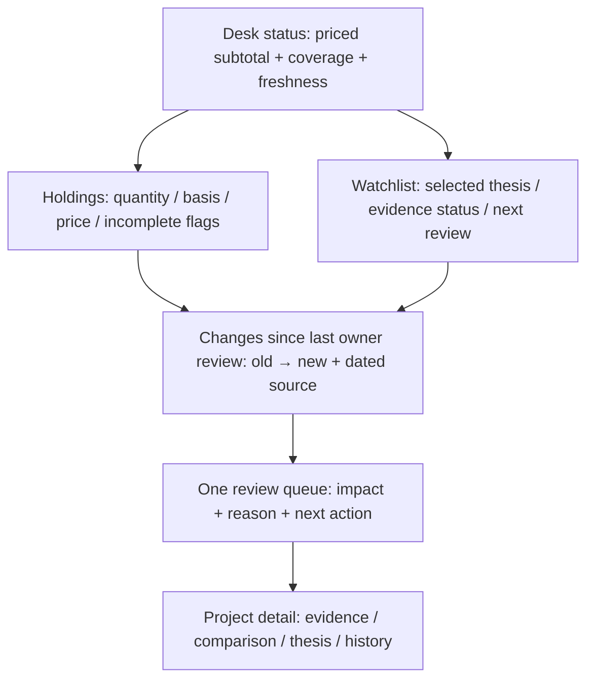

# Daily desk design recommendations

This is a design proposal, not an application edit. The [layout mockup](C:/Users/Kuaya/Documents/CryptoResearch/audits/2026-10-01-codex-system-review/proposed-desk.svg) uses fictional amounts and illustrates hierarchy. Screenshots of the actual isolated app are indexed in [VALIDATION.md](C:/Users/Kuaya/Documents/CryptoResearch/audits/2026-10-01-codex-system-review/VALIDATION.md).

## Make the first screen answer the daily questions

The current desktop has a coherent restrained visual style, useful persistent navigation and explicit demo/live/root context. Preserve it. Replace duplicated priorities/daily-review panels with one ranked queue. Put the questions a user wants answered ahead of implementation diagnostics:

1. **What do I own?** Priced subtotal, pricing coverage and cash/stable allocation, then a concise holdings table.
2. **What am I watching?** A separate watchlist with owner thesis state, latest eligible reports and next review. A report or watchlist entry never creates a holding.
3. **What changed?** Since the last owner review: metric/catalyst/report changes with previous/current values and dated evidence. Price movement alone does not revise an analyst grade.
4. **What needs review?** One queue ranked by impact: failed saves, accounting ambiguity, missing/stale valuations, material evidence changes, unresolved disputes and due reviews. Each row explains the issue and the next action.
5. **Where do the models disagree?** Comparable report context first, then score/claim differences and shared-source caveats.
6. **What supports my thesis?** Owner-selected thesis/version, supporting claims, conditions and unresolved contradictions, with original evidence one click away.

Use “Import report,” “Add project” and “Record transaction” as distinct actions. A single natural-language request can suggest structured fields, but the UI should show the committed object/receipt, not only a generic toast.

## Proposed desktop arrangement

The SVG mockup shows a valuation header, holdings, watchlist, changes and one review queue. Its figures are deliberately fictional. On tablet, stack the holdings/watchlist blocks and keep coverage beside the amount. On phone, use a top navigation/menu and cards for the first four fields of each position; put detailed columns in a horizontally scrolling region or an expanded row.

## Concrete changes by screen

| Screen | Change | Why / acceptance |
|---|---|---|
| Overview | Replace “Portfolio value $0” when all holdings are unpriced with “Value unknown”; show “Priced subtotal $X · Y of Z assets priced,” and stale age separately. | Missing prices do not imply zero. Coverage is visible without reading a footnote. Allocations name their priced denominator. |
| Overview | One review queue, one changes block; retire repeated daily finding cards. | A failure appears once with a clear action and remains until resolved/acknowledged. Daily snapshots are labeled with generation time. |
| Holdings & watchlist | Strong section separation; quantity and units, basis coverage, known realized gain and unknown-basis exclusions, fee totals and BTC-method tooltip. | Watchlisted assets cannot look owned; financial uncertainty is next to the relevant number. Closed positions can be viewed separately without losing historical fees. |
| Portfolio records | Expose a searchable transaction table, source IDs, import rejects/duplicates and reasoned void/correction controls. | The current transaction count and CSV link are insufficient for checking an erroneous entry. Correcting a recorded action does not erase its history. |
| Project research | Preserve search/filter behavior; add filter chips for owned/watched, needs evidence, provider coverage and due review. Show identity and evidence validation as different badges. | Finding a pending identity worked during inspection; keep that useful simplicity. “Verified identity” is not “verified thesis.” |
| Project detail | Addressable, lazy sections; summary with owner thesis and conditions first, then a compact context ribbon (rubric/profile/horizon/dates). | Section URL/back/bookmark returns the user to the same place; one report shape cannot crash every section. Long-page scrolling is optional. |
| Comparison | Freeze the category label within the table; show comparability/exclusions above it; keep provider/model/date/prompt version visible. N/A categories excluded from spread. | At phone width, provider cards or a two-provider selector preserve readable differences. Median remains explicitly descriptive. |
| Evidence & disputes | Group by claim/topic with entity, definition, unit, period and as-of date. Separate changed values, unknown context and actual contradictions. | A newer TVL value is not automatically a contradiction. Source validity and corroboration status are shown independently of [V]/[C]/[I]/[S]. |
| Economics / scenarios | Keep revenue, fees, LP/participant income, holder distributions and emissions distinct. Show announced/implemented state and probability/valuation assumptions. | Network, token and PayFi measures retain sector meaning. Speculative forecasts and missing assumptions are obvious. |
| Reports | PDF “preserved; needs text extraction” card with original download; safe unknown panels. Display full raw/provenance/correction history on demand. | PDF-only and mixed projects work; no inferred grade from a binary file. Raw original and corrected view cannot be confused. |
| Imports | Preview channel/project/provenance and validation results. Retain drafts on failure; persist receipt/status after refresh with an explicit saved-object link. | A rejected report cannot appear saved or lose its editable text. Pending means no confirmed effect yet. |
| Calendar | Review dates and evidence/catalyst dates distinguished; completing a review sets a review cursor, not an analyst fact. | Due reviews give one clear next action and do not alter research history. |
| Exports / recovery | Name each export's inventory and omissions; separate portable JSON, complete package, overlay and clean restore. | A user can choose the artifact needed for disaster recovery without interpreting a generic “complete” label. |
| Privacy / schedules | Display the current root's runtime/task ownership and actual enabled integrations/cadences. Show local-file and external-AI processing boundaries accurately. | A demo cannot inherit real-root scheduler health; disabled market mode cannot claim an active five-minute feed. |

## Typography, contrast, responsive tables and keyboard

Keep the current font family and compact spacing, but use readable 14–16 px body text and stronger secondary text. The measured faint color is below normal-text contrast guidance on both sampled backgrounds. Use at least 4.5:1 for normal text on the actual surface, and do not communicate failure/risk only with color. Current labeled blue favorable and orange downside bars are useful; preserve direction labels and numbers. If historical charts are added, show units, interval, source/age and gaps; no fabricated interpolation across missing observations.

Fix containment before hiding columns: responsive grid tracks/children need a zero minimum width, main content must remain viewport-bounded and `.table-wrap` must scroll within that bound. For long identifiers, provide wrap/copy; an unbroken identifier should not widen the entire page. Essential action columns remain reachable. At 390/768/1440, measure document width and exercise internal scrolling, rather than accepting a screenshot that merely crops the overflow.

Native keyboard focus was visible. Complete tab semantics with labeled tabpanels, roving focus/arrow behavior where appropriate, and a stable status/live region for import/commit results. Preserve drafts/focus on rerender, respect reduced-motion preferences for section movement, and label small icon-only actions. A screen-reader pass is a follow-up acceptance check, not something this audit certifies.

## Proposed daily flow

Open desk → inspect valuation coverage and one review queue → read changes since the last review → open the relevant project context/evidence → compare only compatible reports → record an owner decision or leave a dispute → acknowledge review. Collection/analysis jobs may propose new claims or a thesis revision; they must not replace the owner's selection. Failed saves stay actionable with a receipt and recoverable original input.

Acceptance for this design is practical: all six daily questions are answerable at every tested width, no whole-page overflow, no lost failed input, no PDF-wide failure, no unqualified zero from missing data, and a keyboard user can reach/review/record the same work.
