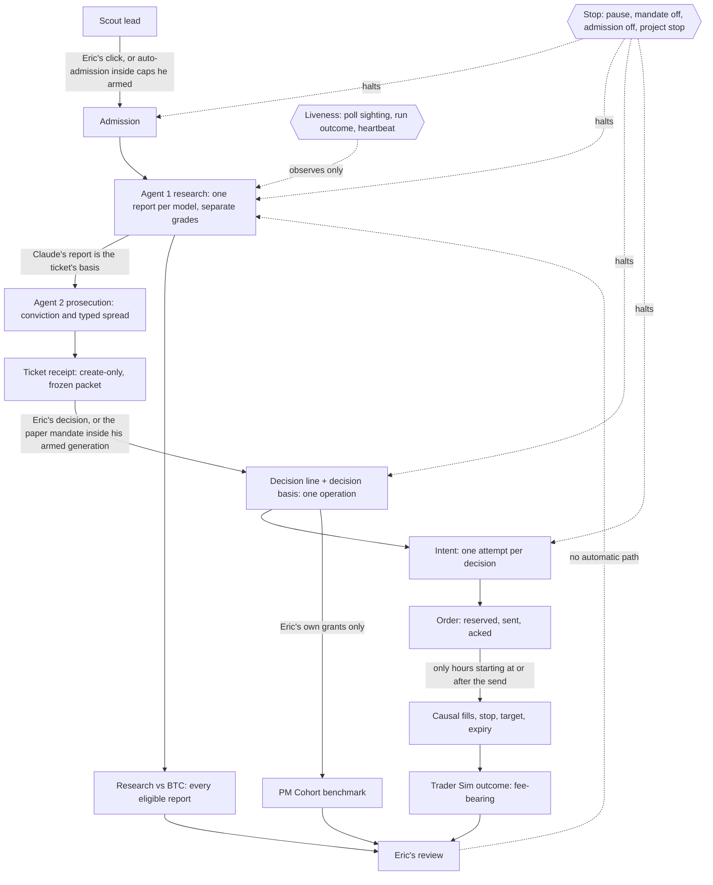

# The desk on one sheet

The lifecycle from a scout lead to Eric's review (CONSTITUTION Part 4, question 2). The drawing follows the combined blueprint of 2026-11-02 §2, which is a proposal: PR #134, closed unmerged at `b462db6`, so its text is not on `main` and is not Eric's approval. Code comments that cite "blueprint 2026-11-02" cite that proposal.

### Where each part runs

| Host | What runs there |
|---|---|
| **GitHub Actions** | `scout-cron.yml` at 11:30 UTC (scheduled runs only while `SCOUT_ENABLED` is `true`), and the `test` check on every pull request |
| **Render desk** | the web service (`server.js` → `dashboard/hosted.js`) and its 30-minute timer: snapshot, reviews, backup, fundamentals, screening, forensics, trader, leads (`jobs.js` `HOSTED_TIMER_JOBS`); the 2-minute research tick |
| **Runner host** | the PC task `CryptoResearch pilot-all`, from the clean runner worktree, during B0–B3; then the Ops-1 Render Cron Job, defined and suspended (#166, `docs/engineering/OPS1_RENDER_CRON.md`), not yet created. One at a time, never both (Q1) |
| **PC offsite backup** | `\CryptoResearch\Hourly`, the only copy of the records off Render. It is not on the lifecycle's path: the desk runs without it |

## What the sheet says

- **Outcomes reach Eric only.** No arrow runs from an outcome to a grade, a rubric, the mandate or admission. Changing any of those is Eric's own act, under the desk's versioning: a published template is never edited (`CLAUDE.md`).
- **Two paths into a decision, both his.** Eric decides a ticket himself, or the paper mandate grants inside a generation he armed, unexpired (`cr-paper-mandate@1`).
- **Two paths into admission, both his.** He clicks "Confirm and request research", or automatic admission admits inside the caps he armed (`cr-lead-admission@1`, off by default).
- **One stop halts every automated arrow on a project** (`cr-automation-gate@1`, PR #131): admission's remaining effects, the pilot's research and Prosecutor sessions, mandate grants, and openings. Only his rearm un-stops it. The desk-wide pause is separate.
- **The three outcome views stay apart:**
  - the Trader Sim: fee-bearing fills;
  - Research vs BTC: every eligible report, traded or not;
  - the PM Cohort: Eric's own grants at the signal price, costs unknown.
- **Liveness observes; it never acts.** A poll sighting, a run's outcome class and a heartbeat say whether the runner is alive. None of them retries, releases a claim or changes authority.
- **The one accepted exception (Q1).** A runner that loses its connection before `complete` leaves its claim `dispatched`. The next run reads it as `reconcile` (exit 3), and Eric reconciles it by hand on Desk Controls. Nothing re-dispatches it, times it out or resubmits it.

## Where each box stands (as of 2026-11-07)

Four different things, never read as one another. Merged is not deployed, and deployed is not operating.

- **Merged on `main`** (Eric's merge; the SHA is the merge commit):
  - the stop gate, #131 `b87a0b4`;
  - the runner's outcome class, #135 `3dbf54c`;
  - the decision basis frozen in the decision's operation, #136 `9558e66` (with the input-blindness tests, #137 `7a11c80`);
  - the runner's credentials, #138 `662b100`; the heartbeat, #139 `062fe98`;
  - Trader Sim replay equivalence, #140 `d94888d`; host recovery, #141 `99148c2`;
  - the poll sighting, #142 `76c58e8`; the attribution view, #143 `f6db9a7`;
  - this sheet and the canon sync, #144 `099b443`; desk controls, #145 `5024179`;
  - audit fixes F1 #146 `c241467`, F2 #147 `ce3294a`, F3 #151 `7d98b5b`, F4 #148 `6928513`, F5 #149 `3d791a5`, F6 #150 `fb529e5`, F7 #152 `8b79e3a`;
  - audit fixes F8 #153 `d6bc158`, F9 #154 `b54cf0f`, F10 #155 `352bc02`, and this sheet's F11 update #157 `fff8d46`;
  - the list of Eric's open decisions, #156 `c988b56` (merged as a list; his answers to it are the 2026-11-03 blueprint's §3);
  - post-remediation hardening N1 #158 `34089b9`, N3 #159 `1230170`, N2 #160 `af03923`, and N4 with this sheet's N7 update #161 `e3e017d`;
  - the autonomy completion blueprint with Eric's ratified answers, #162 `6e2db98`;
  - the runner's unattended mode and revision guard (blueprint PR 1), #163 `94cede6`;
  - honest job and housekeeping status (blueprint PR 2), #164 `21a11fa`;
  - this sheet's host legend and the canon sync (blueprint PR 3), #165 `fbfb640`;
  - Ops-1 defined, suspended: the Render Cron Job's specification and its preflight (blueprint PR 4), #166 `5a8e75b`;
  - the R0 receipt, #167 `363b536`; the System Atlas, #168 `eb4e0b4`, brought onto the v17 tokens, #172 `9fda7d4`;
  - the proof verifier, prove-autonomy: its foundation, #169 `1909597`; its readers for B1, B2, B3 and cutover, #171 `9f6d9aa`; forms and a seal for Eric's evidence, #180 `0013682`;
  - Stage 1.5: GitHub credentials out of the runner's child processes (B1), #173 `1589e0a`; the nine protected files in Invariant 3 (B2), #174 `e672f11`; a PM Cohort record that does not read is refused (B3), #175 `b80f29a`; gross, fees, net and signal against fill (C1), #176 `2e90c49`; GoPlus flags in packets (C2), #177 `d4e2a51`; one real project to the Explorer (C3), #178 `e996ed4`;
  - fixes: a skipped decision line is warned about, #179 `a9b4496`; the Windows record-lock race, #181 `a08a482`;
  - stabilization: the single-project revision guard, #182 `a687c2a`; candle status honesty, #183 `3ce579c`; the daily brief's trader clock, #184 `14133bb`; a lost book is never a new one, #185 `a4d91e3`; the book-identity anchor, #186 `1ff60f7`; the restore hold, #187 `362b005`; its acceptance fixes, #188 `f094662`;
  - this sheet's roadmap, the workspace map and the spec workflow, #189 `da456b7`;
  - the receipt for the repeated R0, #190 `8664635`;
  - this sheet's record of that R0's PASS, #191 (this pull request).
- **Proposed** (not on `main` until Eric merges): the combined blueprint of 2026-11-02 (#134, closed unmerged); the `NEXT_STAGE_*` documents and the roadmap edits to `DESK_STATE.md` in `Documents\CryptoResearch` (local only, no pull request), which are not authority.
- **Deployed: the `/healthz` revision, read at a stated time.** Deployed means the commit on the `revision` line of the online desk's `/healthz`, read back at a stated UTC time, and nothing else: a merge, a Render dashboard or a doctor report is not a readback. Last read: `8664635` (#190) at 06:09Z on 2026-11-07. A later merge is not deployed until it is read back the same way.
- **Operating proof: none yet.** The Ops-1 service is not created. No unattended run on the runner host, no heartbeat configured and observed, and none of the bounded paper milestones B0–B3 is recorded. Fictional fills and passing tests prove code paths, not operation.
  - **R0 reads PASS, 18 of 18 checks.** R0 checks the runner's baseline and its records. It is not an operating run. Eric ran `prove-autonomy r0 --mode=post-merge` from a clean clone on Node 24.21.0, against the real `/healthz`. The receipt is `docs/engineering/OPERATING_PROOF_R0_2026-11-07.md`, and raw evidence stays on Eric's PC.
  - **Sealed baseline:** `da456b722f5ec55edf5689a87ce95c162456dfed`. Sealed manifest SHA-256: `6bbca5599ce1ec8ab34b266febc78ae249cf696691feb9c85eb577293e3e5982`.
  - **Verified receipt merge:** `8664635c784c618abc135ca198cf87e443f12de0` (#190).
  - **Verification time:** 2026-11-07T06:03:27.706Z.
  - **Saved verifier report:** the SHA-256 of its `manifest.json` is `c7ca35b338aee1019a2738a2e30013c1b25a1824b05bd2497acb9733a9168589`. Local only: `operating-proof-2026-11-07-r0-verifyproof-r0-1e9005e4-d93b-49fe-b56b-1d11266469e0` in the evidence folder. This hash is a record, and no command checks it.
  - **What it leaves unproved:** book continuity across restarts, any pilot run and a full restore, as the receipt lists. A later merge that changes anything outside `docs/` or `audits/` reads UNVERIFIED and restarts R0 (`docs/engineering/AUTONOMY_PROOF_CLI.md`, `baseline_current`).
  - **The System Atlas is behind this.** It still says R0 must be repeated. Its text is outside `docs/`, and its rebuild is deferred by Eric.

**Owner questions: answered.** Eric's answers to Q1–Q5 are §3 of `docs/engineering/AUTONOMY_COMPLETION_BLUEPRINT_2026-11-03.md` (#162), and they supersede the proposals in `OWNER_DECISIONS_2026-11-02.md`: Q1 one Render Cron Job (Ops-1) after the PC's supervised proof, one scheduler at a time; Q2 Healthchecks.io, `--max-agents=1`, STALE at 120 minutes; Q3 grouped by decider, researcher model version and execution policy, counts and rows only, no rate before 50 closed positions in a group; Q4 option B, the execution stamp stays `not_recorded` and the protected files untouched; Q5 B0–B3 only after PRs 1–4 are merged and deployed, on NMR if its contract hold has cleared at B0, else a clean-contract candidate already on the desk, by its stored identity, and never a forced fill. Still his and still open: the Law 1 credential. The buy-and-hold baseline comparison is deferred to Stage 2 by his ruling. A5, the PM Cohort's false-empty read, is closed in code by the protected change B3: a record that does not read is an `INTEGRITY` refusal, never a shorter book. Each closed Trader Sim position now states its gross, fees, net and signal against fill in the attribution view (C1), row by row, with no total and no rate. New research and ticket packets now carry GoPlus's contract flags from the saved screen (C2, `packet_mode` `include`): an unanswered check stays unknown, a missing, old or failed screen says so, and nothing is labeled safe. One real project can now go to the Research Explorer, only by the preview's hash from his own terminal (C3); sending the whole desk stays refused, and this work sent no real record.

## The latest merge and deployment

These are two facts with two kinds of evidence.

- **Merge of #190.** Eric merged it at 05:58:59Z on 2026-11-07. The merge commit is `8664635` and the pull request's head was `d76a837`. Evidence: GitHub's record of #190, and `git ls-remote` read `main` at `8664635`. The required `test` check passed on the head (run 42344742892) and on `main` after the merge (run 42344975415): 2116 tests, 2109 pass, 0 fail, 7 skipped.
- **Deployment of #190.** `/healthz` read HTTP 200, `revision 8664635c784c618abc135ca198cf87e443f12de0 (main)`, `started 2026-11-07T05:59:43.944Z`, at 06:09Z on 2026-11-07. Supporting, not the readback: Render's deploy `dep-dbnbs9a9lscs73bsuq9g` (trigger `new_commit`, status `live`, finished 05:59:51Z), and no error, warning or fatal log lines from 05:58:30Z to 06:10:00Z.
- **A merge to `main` deploys.** Render started this deploy about 2 seconds after the merge, with no other step. #186, #187 and #188 show the same `new_commit` trigger. Merging is also the decision to deploy unless that setting changes.
- **What neither shows.** Neither shows that the restore hold has worked on real records. The Render restore steps have never run.

## Roadmap: what comes next, in order

Stabilization stays ahead of autonomy. Live states carry the time they were read. Where no fresh read exists, the last one is dated and the current state is unverified.

1. **Stabilization fixes, #182–#188.** Merged and deployed, not operationally verified. Evidence: above.
2. **Book-identity anchor: installing `CR_TRADER_BOOK_ANCHOR` on Render.** Installed by Eric. Read `established`, signed in to the live desk, at 06:02Z on 2026-11-07, after #190's restart, with first-line hash `ea9b81703ef3349f10aa7a48285f850758201ba78008301612162afc4137e3c4`. Its refusal was read from the code and its tests, and has not been run on the live desk.
3. **Protected-file baseline.** Adopted by Eric on 2026-11-06, at `da456b7`, in Eric's own words in the receipt (#190). The questions that adoption leaves open stay open, as the receipt lists them.
4. **Repeat R0.** Done: PASS at 06:03Z on 2026-11-07, under "Operating proof" above. Any later merge that changes anything outside `docs/` or `audits/` restarts it. The runner read `da456b7` at 06:09Z on 2026-11-07, behind `main` by docs only, so its revision guard refuses it until it is refreshed. `CryptoResearch pilot-all` read Disabled and Hourly read Ready at the same time.
5. **B0, B1, B2, B3.** Not started and not approved. No receipt is on `main`. Gates G1–G4: blueprint §5. Refreshing the runner, the paper mandate and B0's approval are Eric's separate decisions, and this sheet decides none of them. The mandate read on at 06:02Z on 2026-11-07, expiring at 2026-11-08T14:06:13Z.
6. **Ops-1 cutover.** Defined, not created, behind B3: `docs/engineering/OPS1_RENDER_CRON.md`.
7. **Law 1 credential.** Open, and Eric's (under "Owner questions" above). The buy-and-hold baseline is deferred to Stage 2 by his ruling.
