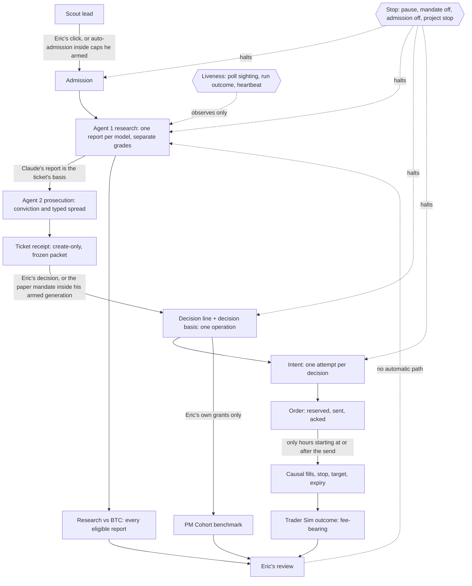

# The desk on one sheet

The lifecycle from a scout lead to Eric's review (blueprint 2026-11-02 §2; CONSTITUTION Part 4, question 2).

## What the sheet says

- **Outcomes reach Eric only.** No arrow runs from an outcome to a grade, a rubric, the mandate or admission. Changing any of those is Eric's own act, under the desk's versioning: a published template is never edited (`CLAUDE.md`).
- **Two paths into a decision, both his.** Eric decides a ticket himself, or the paper mandate grants inside a generation he armed, unexpired (`cr-paper-mandate@1`).
- **Two paths into admission, both his.** He clicks "Confirm and request research", or automatic admission admits inside the caps he armed (`cr-lead-admission@1`, off by default).
- **One stop halts every automated arrow on a project** (`cr-automation-gate@1`, PR #131): admission's remaining effects, the pilot's research and Prosecutor sessions, mandate grants, and openings. Only his rearm un-stops it. The desk-wide pause is separate.
- **The three outcome views stay apart:**
  - the Trader Sim: fee-bearing fills;
  - Research vs BTC: every eligible report, traded or not;
  - the PM Cohort: Eric's own grants at the signal price, costs unknown.
- **Liveness observes; it never acts.** A poll sighting, a run's outcome class and a heartbeat say whether the runner is alive. None of them retries, releases a claim or changes authority.

## Not on `main` yet (as of 2026-11-02)

These boxes are drawn as the build plan intends. Each waits on Eric's merge:
- the decision basis frozen in the decision's operation (#136);
- the runner's outcome class (#135);
- the poll sighting (#142);
- the heartbeat (#139).

Until then, the decision box is the decision line alone, and liveness is the runner's own log.
