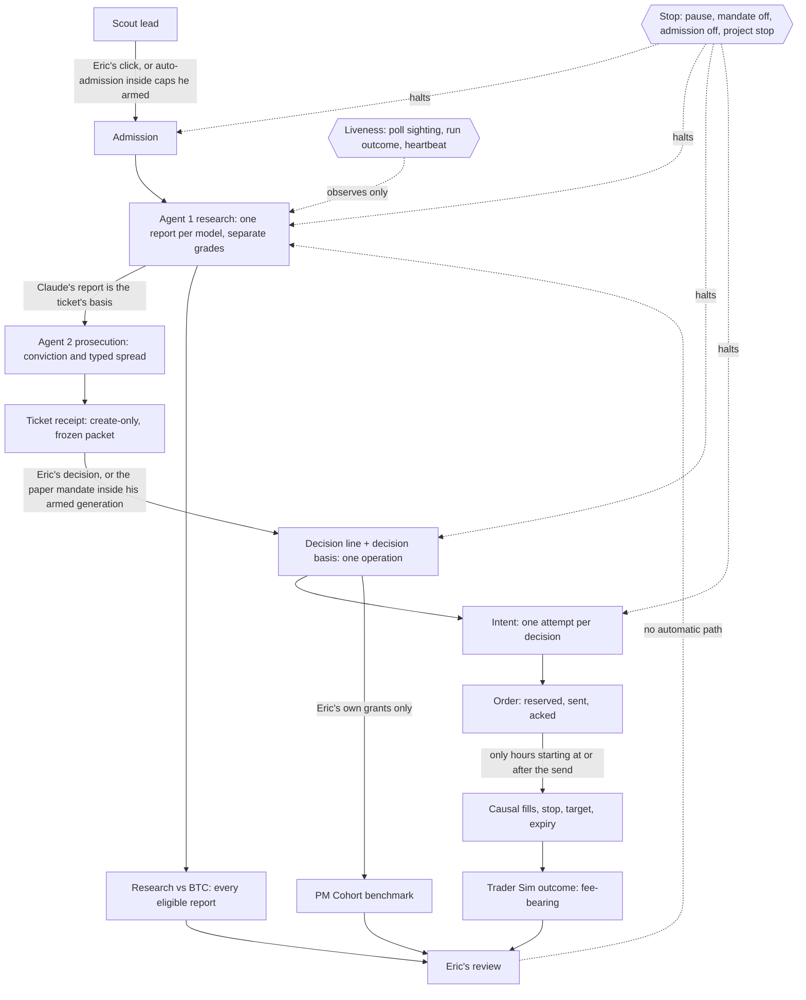

# The desk on one sheet

The lifecycle from a scout lead to Eric's review (CONSTITUTION Part 4, question 2). The drawing follows the combined blueprint of 2026-11-02 §2, which is a proposal: PR #134, closed unmerged at `b462db6`, so its text is not on `main` and is not Eric's approval. Code comments that cite "blueprint 2026-11-02" cite that proposal.

## What the sheet says

- **Outcomes reach Eric only.** No arrow runs from an outcome to a grade, a rubric, the mandate or admission. Changing any of those is Eric's own act, under the desk's versioning: a published template is never edited (`CLAUDE.md`).
- **Two paths into a decision, both his.** Eric decides a ticket himself, or the paper mandate grants inside a generation he armed, unexpired (`cr-paper-mandate@1`).
- **Two paths into admission, both his.** He clicks "Confirm and request research", or automatic admission admits inside the caps he armed (`cr-lead-admission@1`, off by default).
- **One stop halts every automated arrow on a project** (`cr-automation-gate@1`, PR #131): admission's remaining effects, the pilot's research and Prosecutor sessions, mandate grants, and openings. Only his rearm un-stops it. The desk-wide pause is separate.
- **The three outcome views stay apart:**
  - the Trader Sim: fee-bearing fills;
  - Research vs BTC: every eligible report, traded or not;
  - the PM Cohort: Eric's own grants at the signal price, costs unknown.
- **Liveness observes; it never acts.** A poll sighting, a run's outcome class and a heartbeat say whether the runner is alive. None of them retries, releases a claim or changes authority.

## Where each box stands (as of 2026-11-02)

Four different things, never read as one another. Merged is not deployed, and deployed is not operating.

- **Merged on `main`** (Eric's merge; the SHA is the merge commit):
  - the stop gate, #131 `b87a0b4`;
  - the runner's outcome class, #135 `3dbf54c`;
  - the decision basis frozen in the decision's operation, #136 `9558e66` (with the input-blindness tests, #137 `7a11c80`);
  - the runner's credentials, #138 `662b100`; the heartbeat, #139 `062fe98`;
  - Trader Sim replay equivalence, #140 `d94888d`; host recovery, #141 `99148c2`;
  - the poll sighting, #142 `76c58e8`; the attribution view, #143 `f6db9a7`;
  - this sheet and the canon sync, #144 `099b443`; desk controls, #145 `5024179`;
  - audit fixes F1 #146 `c241467`, F2 #147 `ce3294a`, F3 #151 `7d98b5b`, F4 #148 `6928513`, F5 #149 `3d791a5`, F6 #150 `fb529e5`, F7 #152 `8b79e3a`.
- **Proposed** (open pull requests or text only; not on `main` until Eric merges): the remaining fixes from the 2026-11-02 implementation audit, each on its own pull request (F8 #153, F9 #154, F10 #155, and this sheet's update, F11 #157); the protected-core execution stamp (row 9); the runner's move off the PC (Ops-1); the blueprint itself (#134).
- **Deployed: not verified.** The online desk deploys from `main`, but no deployed SHA has been read back. Which commit it runs is Eric's to check on Render.
- **Operating proof: none yet.** No unattended run on a chosen host, no heartbeat configured and observed, and none of the bounded paper milestones B0–B3 is recorded. Fictional fills and passing tests prove code paths, not operation.

**Open owner questions.** The blueprint's §11 defaults are proposals, not Eric's answers, and so are the defaults an agent wrote into code while waiting: Q1 runner host; Q2 Healthchecks and the STALE threshold; Q3 grouping and minimum sample; Q4 protected stamp A or B (the code records `not_recorded` until he decides); Q5 B2 gating. Also his: the design of record (#134) and the baseline and fee-drag comparison. Fee totals already sit beside closed net P&L, so fees are not absent.
