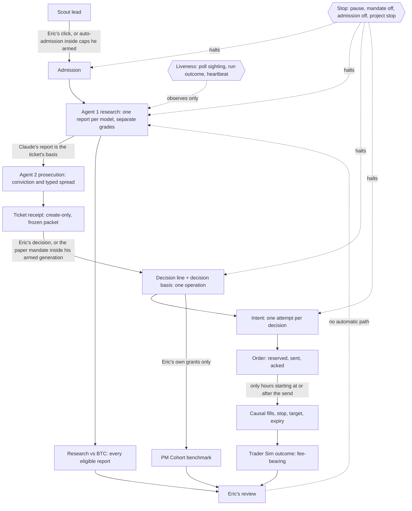

# The desk on one sheet

The lifecycle from a scout lead to Eric's review (CONSTITUTION Part 4, question 2). The drawing follows the combined blueprint of 2026-11-02 §2, which is a proposal: PR #134, closed unmerged at `b462db6`, so its text is not on `main` and is not Eric's approval. Code comments that cite "blueprint 2026-11-02" cite that proposal.

### Where each part runs

| Host | What runs there |
|---|---|
| **GitHub Actions** | `scout-cron.yml` at 11:30 UTC (scheduled runs only while `SCOUT_ENABLED` is `true`), and the `test` check on every pull request |
| **Render desk** | the web service (`server.js` → `dashboard/hosted.js`) and its 30-minute timer: snapshot, reviews, backup, fundamentals, screening, forensics, trader, leads (`jobs.js` `HOSTED_TIMER_JOBS`); the 2-minute research tick |
| **Runner host** | the PC task `CryptoResearch pilot-all`, from the clean runner worktree, during B0–B3; then the Ops-1 Render Cron Job, defined and suspended (#166, `docs/engineering/OPS1_RENDER_CRON.md`), not yet created. One at a time, never both (Q1) |
| **PC offsite backup** | `\CryptoResearch\Hourly`, the only copy of the records off Render. It is not on the lifecycle's path: the desk runs without it |

## What the sheet says

- **Outcomes reach Eric only.** No arrow runs from an outcome to a grade, a rubric, the mandate or admission. Changing any of those is Eric's own act, under the desk's versioning: a published template is never edited (`CLAUDE.md`).
- **Two paths into a decision, both his.** Eric decides a ticket himself, or the paper mandate grants inside a generation he armed, unexpired (`cr-paper-mandate@1`).
- **Two paths into admission, both his.** He clicks "Confirm and request research", or automatic admission admits inside the caps he armed (`cr-lead-admission@1`, off by default).
- **One stop halts every automated arrow on a project** (`cr-automation-gate@1`, PR #131): admission's remaining effects, the pilot's research and Prosecutor sessions, mandate grants, and openings. Only his rearm un-stops it. The desk-wide pause is separate.
- **The three outcome views stay apart:**
  - the Trader Sim: fee-bearing fills;
  - Research vs BTC: every eligible report, traded or not;
  - the PM Cohort: Eric's own grants at the signal price, costs unknown.
- **Liveness observes; it never acts.** A poll sighting, a run's outcome class and a heartbeat say whether the runner is alive. None of them retries, releases a claim or changes authority.
- **The one accepted exception (Q1).** A runner that loses its connection before `complete` leaves its claim `dispatched`. The next run reads it as `reconcile` (exit 3), and Eric reconciles it by hand on Desk Controls. Nothing re-dispatches it, times it out or resubmits it.

## Where each box stands (as of 2026-11-03)

Four different things, never read as one another. Merged is not deployed, and deployed is not operating.

- **Merged on `main`** (Eric's merge; the SHA is the merge commit):
  - the stop gate, #131 `b87a0b4`;
  - the runner's outcome class, #135 `3dbf54c`;
  - the decision basis frozen in the decision's operation, #136 `9558e66` (with the input-blindness tests, #137 `7a11c80`);
  - the runner's credentials, #138 `662b100`; the heartbeat, #139 `062fe98`;
  - Trader Sim replay equivalence, #140 `d94888d`; host recovery, #141 `99148c2`;
  - the poll sighting, #142 `76c58e8`; the attribution view, #143 `f6db9a7`;
  - this sheet and the canon sync, #144 `099b443`; desk controls, #145 `5024179`;
  - audit fixes F1 #146 `c241467`, F2 #147 `ce3294a`, F3 #151 `7d98b5b`, F4 #148 `6928513`, F5 #149 `3d791a5`, F6 #150 `fb529e5`, F7 #152 `8b79e3a`;
  - audit fixes F8 #153 `d6bc158`, F9 #154 `b54cf0f`, F10 #155 `352bc02`, and this sheet's F11 update #157 `fff8d46`;
  - the list of Eric's open decisions, #156 `c988b56` (merged as a list; his answers to it are the 2026-11-03 blueprint's §3);
  - post-remediation hardening N1 #158 `34089b9`, N3 #159 `1230170`, N2 #160 `af03923`, and N4 with this sheet's N7 update #161 `e3e017d`;
  - the autonomy completion blueprint with Eric's ratified answers, #162 `6e2db98`;
  - the runner's unattended mode and revision guard (blueprint PR 1), #163 `94cede6`;
  - honest job and housekeeping status (blueprint PR 2), #164 `21a11fa`;
  - this sheet's host legend and the canon sync (blueprint PR 3), #165 `fbfb640`;
  - Ops-1 defined, suspended: the Render Cron Job's specification and its preflight (blueprint PR 4), #166 `5a8e75b`.
- **Proposed** (not on `main` until Eric merges): the combined blueprint of 2026-11-02 (#134, closed unmerged).
- **Deployed: the `/healthz` revision, read at a stated time.** Deployed means the commit on the `revision` line of the online desk's `/healthz`, read back at a stated UTC time, and nothing else: a merge, a Render dashboard or a doctor report is not a readback. Last read: `fbfb640` (#165) at 16:22Z on 2026-11-03. A later merge is not deployed until it is read back the same way.
- **Operating proof: none yet.** The Ops-1 service is not created. No unattended run on the runner host, no heartbeat configured and observed, and none of the bounded paper milestones B0–B3 is recorded. Fictional fills and passing tests prove code paths, not operation.

**Owner questions: answered.** Eric's answers to Q1–Q5 are §3 of `docs/engineering/AUTONOMY_COMPLETION_BLUEPRINT_2026-11-03.md` (#162), and they supersede the proposals in `OWNER_DECISIONS_2026-11-02.md`: Q1 one Render Cron Job (Ops-1) after the PC's supervised proof, one scheduler at a time; Q2 Healthchecks.io, `--max-agents=1`, STALE at 120 minutes; Q3 grouped by decider, researcher model version and execution policy, counts and rows only, no rate before 50 closed positions in a group; Q4 option B, the execution stamp stays `not_recorded` and the protected files untouched; Q5 B0–B3 only after PRs 1–4 are merged and deployed, on NMR if its contract hold has cleared at B0, else a clean-contract candidate already on the desk, by its stored identity, and never a forced fill. Still his and still open: the Law 1 credential, and the buy-and-hold baseline comparison. A5, the PM Cohort's false-empty read, is closed in code by the protected change B3: a record that does not read is an `INTEGRITY` refusal, never a shorter book. Each closed Trader Sim position now states its gross, fees, net and signal against fill in the attribution view (C1), row by row, with no total and no rate.
