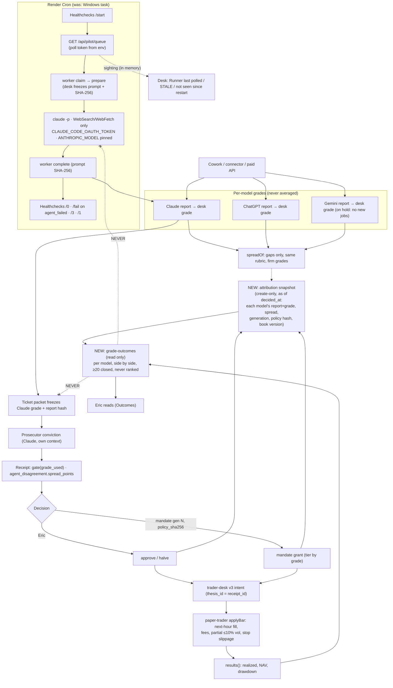

# PROPOSAL — Borrowed tools × Grades

**Status:** PROPOSAL. Design only. No code, setting, schedule or record changed. Nothing here is a decision until Eric merges it and answers §8.
**Date:** 2026-11-02 · **Base:** `main` at `84cb28a` (PR #130) · **Author:** Claude (Claude Code session), for Eric's review.
**Question:** How do the five borrowed tools and patterns fit the desk's grades: per-model research grades, spread, how grades feed admission and mandate grants, and how outcomes should flow back to judge grades?

Citation rules: `path:line` is at `84cb28a`. A URL is a vendor fact read on 2026-11-02. **UNVERIFIED** marks anything not read in code or a primary source. The auditor's build-vs-borrow research and its Tasks 1–4 are **not in the repository**. They are cited here only as the brief that commissioned this proposal.

---

## 0. Verdicts in one table

| # | Candidate | Verdict | One reason |
|---|---|---|---|
| 1 | Render Cron Job running `pilot.js --pilot-all --desk=online` | **Adopt**, with 3 code prerequisites | The online runner already talks to the desk only over HTTPS (`scripts/pilot.js:850`, `:653`), so it needs no disk. Render guarantees one active run per cron job ([render.com/docs/cronjobs](https://render.com/docs/cronjobs)). Two things are PC-bound today: the secrets file and the pending-submission folder (`pilot.js:802`, `:833`, `:675`). |
| 2 | `claude setup-token` → `CLAUDE_CODE_OAUTH_TOKEN` on the cron job only, never `--bare` | **Adopt** | The launcher already passes exactly this variable and never `--bare` (`pilot.js:157`, DESK_STATE.md:171). The token "can only make model requests … can't fetch claude.ai connectors" ([code.claude.com/docs/en/authentication](https://code.claude.com/docs/en/authentication)), which tightens the isolation DESK_STATE.md:180 could only document. |
| 3 | Healthchecks.io dead-man's switch plus a desk "runner last polled" / STALE line | **Adopt, amended** | Exit codes alone are not enough. A session that fails (expired token, CLI error) is released `agent_failed` and the run **exits 0** (`pilot.js:761`, `:948`, `:962`), so an exit-code-only heartbeat stays green while no grade is produced. Ping `/fail` on any `agent_failed`, not only on a non-zero exit. |
| 4 | Freqtrade/Hummingbot paper-fill patterns | **REJECT as new work** (pattern already present) | Every listed pattern is already in protected `paper-trader.js`: fees (`:806`, `:990`, `:1025`), stop slippage (`:148`, `:987`), partial fills at 10% of hourly volume (`:147`, `:1013-1018`), and fills only from hours that start at or after send (`:984-985`). Re-adopting it would add a second fill model. |
| 5 | QuantStats-style metrics + NautilusTrader "one code path" rule, for the outcome ledger | **Pattern only, narrowed** | The book already computes realized P&L, NAV by hour, max drawdown and vs-BTC (`paper-trader.js:1077-1118`). What is missing is **per-grant attribution to each model's judgment**. Build that as a read-only module over the existing journal, with a small metric set. No Sharpe or Sortino below the sample floor. |

---

## 1. The grade pipeline as it exists (ground truth)

| Stage | What happens | Where |
|---|---|---|
| Research | Each model researches separately. The evidence packet **excludes other models' reports and scores**. | `core/research.js:870` `evidencePacket`, `:908` `excluded` |
| Per-model grade | The desk's calculated grade from each report's assessment, never the model's own total. A range stays two ends. A withheld grade is not a grade. | `core/rubrics.js:103` `gradeAssessment`; `core/report-delta.js:31` `gradeOf`; `core/compare.js:24` `latestByProvider` |
| Model spread | Claude against ChatGPT and Gemini: firm grades only, same rubric only, never averaged. | `core/spread.js:53-92` `spreadOf` |
| Ticket basis | **Only Claude's** latest eligible report is frozen into the ticket packet. ChatGPT's and Gemini's grades are not. | `core/tickets.js:250-273` `researcherOf`, `:688` packet `researcher` |
| Gate grade | A range is read at its low end. Withheld or none means no grade. | `core/tickets.js:276-283` `gateGrade` |
| Sizing gate / admission | Grade floors (`min_grade_any`, `min_grade_new_entry`), contract tier and exit proof. The result is recorded as `grade_used`. | `core/tickets.js:416-475` `gate` |
| Prosecutor spread | The receipt's `agent_disagreement` holds researcher grade, prosecutor conviction and `spread_points` (researcher minus prosecutor). | `core/tickets.js:1493-1498`; `core/spread.js:93-115` |
| Mandate grant | Tier from the receipt grade: 50–54 halve, 55+ approve, under 50 never. Candidates go highest grade first. The decision line records `grade_used`, `generation` and `policy_sha256`. | `core/tickets.js:1553-1556` `mandateTierOf`, `:2607` `mandateSweep`, `:2676` sort, `:2685` `decide`, `:1917` mandate line |
| Authority at opening | The grant's generation and policy are re-read at every opening and every hour. | `core/mandate-authority.js:264-276` `grantAuthority` |
| Paper Book fill (Trader Sim) | A v3 intent carries `thesis_id = receipt_id`, `decision_id` and `project_id`. The reservation freezes the grant, the exit cap and the venue fees. | `core/trader-desk.js:555`, `:649`; `core/paper-trader.js:796-807`, `:965-1031` `applyBar` |
| Outcome, report level | Each eligible report's return vs BTC at 30/60/90/120 days from the **run's packet time**, per model. Medians appear only from 20 matured reports. Never ranked. | `core/report-outcomes.js:21-23`, `:31`, `:95-105` `startOf`, `:108` `measure`, `:194` `byModel` |
| Outcome, PM Cohort | `cr-paper@1`: entry at the hourly price at or before the decision. **Fees and slippage unknown.** Shadow lines for $0 tickets. | `core/paper.js:16-26`, `:36` `MIN_CLOSED`, `:279` `shadows` |
| Outcome, Trader Sim | `cr-paper@3`: realized net of fees and slippage, NAV by hour, max drawdown, vs BTC. | `core/paper-trader.js:1077-1118` `results` |

**Three facts that shape everything below:**

1. **Only one model's grade acts.** Admission, sizing and mandate tier read Claude's grade alone (`tickets.js:255`, `:424-434`, `:1553`). ChatGPT's and Gemini's grades reach the trade path only as spread alerts (`spread.js:60-92`). The Prosecutor's conviction acts only through a fatal-flaw hold (DESK_STATE.md:80). So "which model's judgment is earning" has two parts: the grade that acted, and grades that were on record but not acted on.
2. **Today's outcomes are measured at signal price.** `report-outcomes` starts at the packet capture time (`:95-105`). `cr-paper@1` starts at the decision-time hourly price with unknown costs (`paper.js:16-18`). Only Trader Sim measures a realistic fill. No code joins Trader Sim results back to a grade per model.
3. **The canon does not say how a grade is scored against an outcome.** It says the opposite of a score: "not a forecast, an accuracy figure or a ranking of the models, and it changes no grade" (`report-outcomes.js:218`; also `:21-23`, `paper.js:398`). §4 therefore proposes a *descriptive* attribution and leaves the scoring rule to Eric (§8 Q1).

---

## 2. Per-candidate analysis

### Candidate 1: Render Cron Job runs `pilot.js --pilot-all --desk=online`

**a. Where it touches the grade pipeline.** At the research and Prosecutor steps only. The runner polls (`pilot.js:850` `pollOnline` → `GET /api/pilot/queue`, `frontdoor.js:182`), claims and prepares through the worker routes (`pilot.js:653` `workerCall`; `core/pilot-worker.js`), runs one `claude -p` (`pilot.js:458-475`) and posts the answer with its prompt SHA-256. The desk saves it, and the grade then exists. It never touches the gate, the mandate, the trader or outcomes; those run on the server's `trader` job timer (`core/jobs.js:233`).

**b. Does it change what a grade means, when it's produced, or who acts on it?**
- **When:** yes. Grades get produced on the cron cadence instead of only while the PC is awake.
- **Who acts on it:** no. The same desk gates act on the grade.
- **What it means:** yes, through **model drift**. The launcher passes `--model` and `--effort` from Eric's `%USERPROFILE%\.claude\settings.json` (`pilot.js:180-195`, DESK_STATE.md:171). A Render container has no such file, so an unpinned cron would grade with the CLI's default model. A grade from another model version is another judgment. Guard: set `ANTHROPIC_MODEL` on the cron job. The report already records `model_version` (`tickets.js:266`).
- **Grades while the desk shows the runner STALE:** pilot grades cannot be produced while the runner is truly not running. Grades can still arrive from other channels: Cowork or the connector, ChatGPT through its connector, or the paid-API runner (`research.js`; CLAUDE.md "Agentic desk pass"). Mandate grants on receipts already saved keep running on the server timer. The desk should show both facts: "Runner: STALE since …" and "Paper mandate: on, generation N".
- **A false STALE:** `--pilot-all` runs sessions synchronously, each up to `timeoutMin` 60 (`pilot.js:56`, `:466`), and re-polls only after each dispatch (`pilot.js:952`). A run that is working can therefore go about 60–70 minutes without polling. The STALE threshold must cover this (§5 F10).

**c. Grade-to-outcome loop.** No change, except that every report or receipt should carry the channel that produced it, so attribution can tell a pilot grade from a Cowork grade (`reports.js:1399` already records `channel`).

**d. Fill realism.** None.

**e. Failure modes:** F1–F7 and F10 in §5.

**f. Cost:** §6.

**Prerequisites (code in `pilot.js`, not protected):**
1. The tokens come from `secrets.json` under `os.homedir()` today (`pilot.js:802`, `:833-838`, `:642`). On cron they must come from the environment. `launchEnv` already drops every non-allowlisted variable from the session (DESK_STATE.md:172), so the session never sees them. That needs a test.
2. Pending submissions are written to `~/.cryptoresearch/pending-submissions` (`pilot.js:675`, `:770`). A cron job has no persistent disk ([render.com/docs/disks](https://render.com/docs/disks)), so on a lost `complete` the answer is gone with the container. The claim stays `dispatched` and goes to Eric's reconcile, so it is safe (nothing double-saves) but costs a session. Print the IDs and `text_sha256` only (never the claim token or text) to stdout so Render's log shows what was lost.
3. The run log `pilot-all.jsonl` (`pilot.js:804`) is also ephemeral. Render's log stream replaces it, so print the same JSON line to stdout.

### Candidate 2: `claude setup-token` → `CLAUDE_CODE_OAUTH_TOKEN`, cron job only, never `--bare`

**a. Touch points.** Authentication of each `claude -p` session only. It is already allowlisted in `launchEnv` (`pilot.js:157`). The probe deliberately strips it so the probe can never bill (`pilot.js:405`).

**b. Meaning, timing, actor.** No change, as long as the token belongs to Eric's subscription. The docs say an OAuth token "is tied to the subscription of the person who ran `claude setup-token`" ([code.claude.com/docs/en/authentication](https://code.claude.com/docs/en/authentication)). A token whose sign-in carries no connectors also makes the connector exclusion in DESK_STATE.md:180 a property of the credential, not just of the four launch flags.

**c, d.** No effect on the outcome loop or fill realism.

**e. Failure modes.**
- **Token expires after 1 year, or is revoked.** The docs say the token lasts one year and that "Claude Code keeps sending the value you set after a request fails with a 401" ([authentication docs](https://code.claude.com/docs/en/authentication)). Each failed session is released `agent_failed`, still counts against the day's session ceiling (`pilot.js:634`, `:749-761`) and **exits 0**. This is F3 and F8 in §5.
- **`ANTHROPIC_API_KEY` set on the cron.** It outranks the OAuth token in the credential order, which would switch billing to the API ([authentication docs](https://code.claude.com/docs/en/authentication)). `launchEnv` already removes it (DESK_STATE.md:172). Prerequisite: a test that asserts this under a cron-shaped environment.
- **Third-party reports of 401s on freshly issued tokens.** **UNVERIFIED**, from claudeissues.com, not Anthropic. The canary run (Task 4) is what proves the token on the real CLI.

**f. Cost:** one secret with a known expiry. No vendor, no state.

### Candidate 3: Healthchecks.io dead-man's switch plus desk "runner last polled" / STALE

**a. Touch points.** The runner's start and finish (`pilot.js:863` `runAll`, `:962` exit code) and the poll route (`core/pilot-poll.js`), which is read-only and keeps its rate counts in memory (`pilot-poll.js:6-15`). It touches no grade.

**b. Meaning, timing, actor.** It changes none of them. It only states whether the grade producer is alive.

- **What the desk should show** (proposed words, rendered from an in-memory timestamp; nothing written, like `desk_status.assistants`, CLAUDE.md connector handoff):
  - "Runner: last polled 14:32 (12 min ago)"
  - "Runner: STALE, last polled 11:02 (3 h ago)"
  - "Runner: not seen since the desk restarted at 09:10." This is unknown, never fresh and never STALE.
- **Count worker-route calls as sightings too.** A run that is preparing or completing is alive (`pilot-worker.js` claim, prepare, complete).

**Amendment: why exit codes alone are not enough.** In `runAll`, a dispatch whose session failed has `row.stop = 'agent_failed'`, so its outcome is `not_dispatched` (`pilot.js:948`). The exit code is 1 only for a thrown error and 3 only for needs-Eric (`:962`). An expired token, a CLI that will not start a session, or a model error all produce exit 0 with no grade. Proposed mapping:

| Run result | Ping | Healthchecks reads |
|---|---|---|
| Start | `GET …/<uuid>/start` | Run began; grace time bounds it |
| 0, nothing failed | `…/<uuid>/0` | Up |
| 0 with any `agent_failed`, or `isolation` refused | `…/<uuid>/fail` | Down |
| 3, needs Eric (reconcile) | `…/<uuid>/3` | Down: Eric must reconcile |
| 1, error | `…/<uuid>/1` | Down |

The endpoints and the 0 = success / non-zero = failure meaning come from [healthchecks.io/docs/http_api](https://healthchecks.io/docs/http_api/). The rate limit is 5 pings a minute per check, and a run makes two. **Payload rule:** a bare GET with no body, so no project name, ID or count leaves the runner. The ping URL lives in Render's environment only. A ping failure is ignored with a 5 s timeout and never changes the exit code or a dispatch.

**c, d.** No effect on the outcome loop or fill realism.

**e. Failure modes:** F8, F9 and F10 in §5.

**f. Cost:** one vendor, one secret URL, one desk state (fresh / STALE / unknown). It earns its place only once the runner is off the PC. While the PC task is the runner, Eric is at the PC anyway.

### Candidate 4: Freqtrade/Hummingbot paper-fill patterns — REJECT as new work

**a. Touch points, verified line by line.** Every pattern is already in the protected Paper Book. Freqtrade is GPL, and nothing below was copied from it. These are the desk's own red-team results (DESK_STATE.md:562-570).

| Pattern | Already implemented |
|---|---|
| Fees, maker/taker, unknown refuses | `paper-trader.js:806` frozen per order; `:990` exit fee; `:1025` fill fee; DESK_STATE.md:558 |
| Slippage on stops | `STOP_SLIPPAGE_BPS` 25 (`:148`), `stopFill` (`:987`); a gap through the stop fills at the open (`:1002`) |
| Partial fills | `FILL_SHARE_MAX` 0.1 of hourly volume (`:147`, `:1013-1018`) |
| Fill on the next candle, never the signal candle | `live = b.t >= o.live_from` (`:984-985`); intent prices from a *closed* hour (DESK_STATE.md:604, :615) |
| Worst case within the hour | Stop taken over target (`:1001-1004`); a buy hour checks its stop, never its target (`:1029`) |

**b.** It changes nothing about grades. **c.** Nothing new. **d.** See below. **e.** None. **f.** Zero.

**d. Fill realism vs grades (the part that matters).** The realistic fill already exists. What the grade loop lacks is *using it*. Today a grade's outcome is read at signal price in two places:
- `report-outcomes` starts at the packet capture time (`report-outcomes.js:95-105`).
- PM Cohort entry is the hourly price at or before the decision, costs "unknown" (`paper.js:16-18`).

Proposal (§4): **a grade's *trading* outcome is read only from Trader Sim fills.** The other two stay, labeled "price after the report" and "PM Cohort (signal price, costs unknown)". They are never presented as what a grade earned. One gap is recorded, not fixed: `FILL_SHARE_MAX` is not frozen on the order (`paper-trader.js:806` freezes fees and stop slippage only), so the attribution snapshot records the book version (`cr-paper@3`). Any change to the constant needs a version bump through a [P] PR.

### Candidate 5: QuantStats-style metrics + "backtest and live run the same code", for the outcome ledger

**a. Touch points.** Read-only over `paper-trader.js` exports (`results` `:1077`, `intents` `:1056`, `hours` `:1068`) and `trader-desk.js` `view` (`:683`). The new module must not be inside the protected list (`tests/trader-boundary.test.js:34`).

**b.** It changes no grade, gate or decision. It changes what Eric can *see* about grades.

**c.** This is the design in §4.

**d.** Every metric is computed from fills, never from signal prices.

**The NautilusTrader rule, made local:** there is exactly one fill model, `paper-trader.js` `applyBar`. Any future replay or stress test (the Codex roadmap's AT-2, an uncommitted file in the main checkout, **UNVERIFIED** as canon) must drive `applyBar` on a scratch fictional workspace, never a second simulator. Metrics read the journal only.

**Metric set, kept small** (decimal.js `add`/`sub`/`mul`/`div`/`cmp`, `core/decimal.js:146`):
- realized net P&L;
- R-multiple: realized ÷ planned loss at stop, from the reservation's `loss_at_stop_usd` (`paper-trader.js:799`);
- hit rate;
- maximum adverse excursion from the position's hours;
- fill ratio: filled ÷ ordered;
- fill vs signal: average fill price against the packet's market price;
- holding hours;
- vs BTC over the same hours.

**Not adopted:** Sharpe, Sortino and Calmar. They need a return series per strategy; with mandate caps of 1 grant a day and 2 open (DESK_STATE.md:69), 20 closed trades is weeks away, and the desk's floor is 20 (`report-outcomes.js:31`, `paper.js:36`).

**e.** F11–F17 in §5. **f.** One module, one record type, one view. No vendor.

---

## 3. Grade lifecycle after these changes (one page)

---

## 4. The grade-to-outcome loop (answers c and d)

### 4.1 What "attach outcomes to each model's grade" can honestly mean here

| Judgment on record at the grant | Did it act? | What its outcome can show |
|---|---|---|
| Claude's research grade (`grade_used`) | **Yes.** It set admission and tier. | Trader Sim result of the grants it caused, by grade band (50–54, 55–64, 65+) and by decider (Eric or mandate) |
| Prosecutor conviction and verdict | Only through a fatal hold | Results split by conviction band and by `spread_points` band. Did a large researcher-minus-prosecutor spread lose more? |
| ChatGPT challenge verdict (if saved before the decision) | No, it is advisory (DESK_STATE.md:131) | Results split by agree / disagree / insufficient |
| ChatGPT's and Gemini's latest eligible grades at `decided_at` | **No** | "On record, not acted on": results of the same grants split by whether that model's grade would have cleared the same floor. Plus its existing price-after-report row (`report-outcomes`) |

Each row is computed separately for that model. **No figure combines two models.** Columns keep the fixed model order (`report-outcomes.js:194` `PROVIDERS.map`). No "best model" line and no sort by result.

### 4.2 The minimum record per grant: the attribution snapshot

- **Where:** a create-only file `projects/<id>/tickets/attribution/<decision_id>.json`, backed up with the project.
- **When:** written as a decision *effect* in `tickets.js` (not protected), beside the existing `effects` (`tickets.js:1985` `effectsOf`, `:2111` `reconcileEffects`).
- **What it may read:** frozen records only, never the current settings.

| Field | Source |
|---|---|
| `decision_id`, `receipt_id`, `project_id`, `decided_at`, `decided_by` (Eric or `mandate:cr-paper-mandate@1`) | decision line |
| `mandate.generation`, `mandate.policy_sha256`, `tier`, `grade_used` | **the decision line's own mandate block** (`tickets.js:1917`), never `mandateOf()` now |
| `gate.version`, `sizing` hash, `suggested_risk_usd`, `pm_approved_risk_usd` | receipt `desk` (`tickets.js:1471-1491`) |
| `models.claude`: `report_id`, `run_id`, `model_version`, `prompt_version`, `rubric_version`, `sector_profile`, `channel`, grade `{kind, value, low, high, display}`, `verdict`, `analysis_at`, `original_sha256` | receipt `researcher` plus the report (`tickets.js:1467`, `:250-273`) |
| `models.chatgpt` and `models.gemini`: same fields for each model's latest eligible report **saved at or before `decided_at`**, else `{ none: reason }` | `compare.latestByProvider` over reports filtered by `imported_at ≤ decided_at` |
| `prosecutor`: `conviction_score`, `verdict`, fatal count; `spread_points` | receipt `agent_disagreement` (`tickets.js:1493-1498`) |
| `model_spreads`: each Claude-vs-other gap or its "not compared" reason, never averaged | `spreadOf` at `decided_at` (`spread.js:53`) |
| `challenge`: ChatGPT challenge receipt ID and verdict if saved before `decided_at` | `ticket-challenges.js` |
| `signal`: packet `market` price and `captured_at`; the exit reading that capped size | packet (`tickets.js:689`); reservation `exit` (`paper-trader.js:805`) |
| `fill_model`: `cr-paper@3`, `FILL_SHARE_MAX`, `STOP_SLIPPAGE_BPS`, venue fees, lot, minimum notional; the candle pool frozen for the pair | `paper-trader.js:147-148`, `:806`; `paper/candles/sources.jsonl` |
| `intent_id` (derived) | `trader-desk.js:119` `intentIdOf(decision, 'open')`, so the fill joins by ID, never by project or time |
| `snapshot_sha256`, `late: bool` | the snapshot's own canonical JSON; `late` when `reconcileEffects` completed it after a failure |

The outcome is **never stored**, which is the desk's convention (`report-outcomes.js:11-12`). A new read-only `core/grade-outcomes.js` joins snapshot → `pos-<intent_id>` in `paper-trader.results()` and the fill events.

### 4.3 How fills judge a grade (d)

- **Entry** is the average of actual fills (`paper-trader.js:1089`), never the packet or decision price. "Fill vs signal" is shown as its own column, so slippage is visible, not hidden in P&L.
- **Partial fill:** the outcome is on the filled quantity, with the fill ratio beside it. A grant that never filled is **"Not filled"**, a separate count, never a $0 result.
- **Unsettled book** (`settlementAt`, `paper-trader.js:516`): the grant's figures read "recorded balance, not settled" and are excluded from every count until settled.
- **No fill data** (no candle source, GAP, unfunded book): "—" with the book's own reason (`results().unknown`), never 0.
- **Stop exits** carry their slippage and taker fee already (`:987-992`), so an R-multiple below −1 is real and shown as such.

### 4.4 No leakage: no model sees its own score while grading

Today this holds:
- The research packet excludes "other models' reports and scores" (`research.js:908`).
- The Prosecutor reads only its frozen packet (DESK_STATE.md:146).
- Local roles cannot Read `paper/` or `projects/` (DESK_STATE.md:146, `scripts/pilot-role-guard.js`).
- Online sessions have WebSearch and WebFetch only (`pilot.js` launch, DESK_STATE.md:163).
- The poll route returns codes and IDs only (`pilot-poll.js:13-15`).

Proposed invariant and its test:
- No prompt, packet, ticket prompt, challenge target or poll body may contain any attribution or outcome field.
- Add `'paper and grade outcomes'` to `excluded` (`research.js:908`).
- The outcome routes stay behind sign-in.
- Test: build every prompt for a fictional project that has snapshots and closed positions, and assert no snapshot key, `realized_pnl`, R value or hit rate appears.

The Codex roadmap's FB-1 "bounded outcome context" is the one item that would break this. It needs Eric's explicit word (§8 Q5).

---

## 5. Failure modes and guards (e)

| # | New false, stuck or stalled state | Guard |
|---|---|---|
| F1 | Cron double run | Render keeps one active run per cron job and delays the next ([cronjobs](https://render.com/docs/cronjobs)). The desk claim gives one dispatch per project under the workspace lock (DESK_STATE.md:294). The tmp lock (`pilot.js:803`) is per-container and only covers within one run. |
| F2 | A **manual** cron trigger cancels the active run mid-session ([cronjobs](https://render.com/docs/cronjobs)) | The claim stays `dispatched` with an unknown outcome, so it goes to reconcile (exit 3 next run) and never runs twice. There is no success ping, so Healthchecks alerts after grace. Runbook: never trigger manually while a run is live. |
| F3 | OAuth token expired or revoked after 1 year: every session 401s, the run exits 0, and no grade appears | Ping `/fail` on any `agent_failed` (§2 C3). Desk STALE does *not* catch it, because the runner still polls. Calendar the expiry. A session ceiling of 6 a day bounds wasted reservations (DESK_STATE.md:278). |
| F4 | PC task and Render cron both enabled | The desk claim prevents a double dispatch, but both spend the session ceiling. Acceptance for Task 3d: `pilot-task.ps1 -Status` shows disabled before the cron is enabled. The poll sighting records the runner's declared host (`User-Agent: cr-pilot/<host>`), and the desk names it. |
| F5 | Unpinned model on cron (no `settings.json`) changes what a grade means | `ANTHROPIC_MODEL` is required on cron; the runner refuses to start without it when `CR_RUNNER_HOST=render`. `model_version` is in the report and the snapshot. |
| F6 | Claude Code CLI update changes flags | The preflight already fails closed with exit 1 (DESK_STATE.md:173-174). Pin the CLI version in the cron build command. |
| F7 | Lost `complete` on an ephemeral disk: answer gone | Claim → reconcile (exit 3, already the behavior). stdout carries IDs and `text_sha256` only. Nothing is saved twice. |
| F8 | Heartbeat vendor down: false "down" alert, or no alert | Pings never affect exit or dispatch (5 s timeout, ignored). Desk STALE is the independent second signal. |
| F9 | Ping URL leaked: forged "up" pings | The URL is in Render env only. Desk STALE is independent of it. |
| F10 | False STALE while a long session runs (up to `timeoutMin` 60, `pilot.js:56`, no poll during it) | STALE threshold = cron interval + `timeoutMin` + 30 min (2 h at 30 + 60 + 30). Worker-route calls count as sightings. After a desk restart it reads "not seen since restart", never STALE. |
| F11 | Outcome attributed to the wrong mandate generation | The snapshot copies `generation` and `policy_sha256` from the decision line (`tickets.js:1917`), never from settings. The join is by `decision_id` → `intent_id`. Test with two generations. |
| F12 | Outcome attributed to a newer report (a new Claude report saved between ticket and fill) | The snapshot freezes the *receipt's* `report_id` and `original_sha256`, not `latestByProvider` now. Test. |
| F13 | A report quarantined or excluded after the fill | The snapshot keeps the as-of grade. The read says "since quarantined" next to it (as `checkin` does, CLAUDE.md review check-in). It is never silently dropped or regraded. |
| F14 | Unfilled, partial or unsettled grants read as $0 or as losses | Separate states: Not filled, Partial (ratio), Unsettled. Unknown is never 0 (§4.3). |
| F15 | Signal-price outcomes read as what a grade earned | Labels: "price after the report" and "PM Cohort (signal price, costs unknown)". The "earned" wording only on Trader Sim rows. |
| F16 | The snapshot write fails after the decision is recorded | It is an idempotent effect. `reconcileEffects` completes it from frozen records with as-of = `decided_at` and `late: true`. **It never blocks the trader**, and its absence reads "attribution missing". |
| F17 | Sample too small to mean anything | No median, hit rate or R statistic before 20 closed per model per cell (`report-outcomes.js:31`, `paper.js:36`). Counts only until then. |

---

## 6. One-sheet cost (f), against CONSTITUTION Part 4 Q2 (`docs/CONSTITUTION.md:75`)

| Candidate | Vendors | Secrets / tokens | New states | Removes | One sheet? |
|---|---|---|---|---|---|
| 1 Render Cron | 0 new (Render already hosts the desk); +1 service, +1 bill line (per-minute pricing **UNVERIFIED**) | Poll and worker tokens move to Render env (no new tokens) | none new | Dependence on the PC being awake. The `conhost` task-wrapper issue noted in the uncommitted Codex DESK_STATE draft. Windows Task Scheduler in operations (the code stays for local use). | Yes |
| 2 setup-token | 0 | +1 (`CLAUDE_CODE_OAUTH_TOKEN`, 1-year expiry) | none | — | Yes |
| 3 Healthchecks + STALE | +1 (Healthchecks.io) | +1 (ping URL) | Runner: fresh / STALE / not seen since restart | Silent runner death after leaving the PC | Yes |
| 4 Fill patterns | 0 | 0 | 0 | — | **REJECT**: already built; re-adopting adds a second fill model |
| 5 Metrics + one-code-path | 0 | 0 | Attribution: present / late / missing; grant: filled / partial / not filled / unsettled | The unanswered "which judgment is earning", without a second simulator | Yes |

Q3, "failure state when the network drops" (`CONSTITUTION.md:76`): every row in §5 ends in a named state (reconcile, STALE, unsettled, missing). None ends in a timeout-to-done. Q4: nothing here lets a model choose size; all of it is reads or a create-only snapshot.

---

## 7. Ranked build order, mapped to the auditor's Tasks 1–4

Each item is one PR, `node dashboard/cli.js test` green, and Eric merges. None touches a protected file.

| Rank | Task | PR | Acceptance criteria | Test that proves it |
|---|---|---|---|---|
| 1 | **T1 Stop halts pilot** | `pilot-claims.js` `claim()` refuses a project whose autonomy record is suspended, the same way it refuses on pause (`:133`). The poll already reports `suspended` (`pilot-poll.js:53`). This closes the residual limit in DESK_STATE.md:392. | `tickets autonomy 
 --stop` means no claim, no prepare, no session for that project. Other projects are unaffected. `--rearm` restores it. Nothing is written on refusal. | `tests/pilot-claims.test.js`: stop → `claim` returns `suspended`, and the claims file is byte-identical. Rearm → claimed. |
| 2 | **T3a Runner reads env** | `pilot.js`: `CR_PILOT_POLL_TOKEN` and `CR_PILOT_WORKER_TOKEN` from env before `secrets.json`. Pending-submission and run-log lines go to stdout (IDs and hashes only). `ANTHROPIC_MODEL` is required when `CR_RUNNER_HOST=render`. | Tokens are never printed or passed to a session. The PC path is unchanged when env is unset. | `tests/pilot-runner.test.js`: env token used; `launchEnv` output has no `CR_*` and no `ANTHROPIC_API_KEY`; stdout has no token or answer text; a missing model on render refuses before any claim. |
| 3 | **T3b Desk liveness** | `pilot-poll.js` and `pilot-worker.js` record the last accepted call (time, declared host) **in memory**. The Daily Brief and Outcomes show fresh / STALE / not seen since restart. | Reading writes nothing. The STALE threshold is 2 h (F10). A restart reads "not seen". | Unit: poll → fresh; clock +121 min → STALE; new process → not seen; the workspace is byte-identical after reads. |
| 4 | **T3c Heartbeat** | `pilot.js`: optional `CR_HEALTHCHECK_URL`; `/start`, then `/0`, `/fail` (any `agent_failed` or isolation refusal), `/3` or `/1`. | Exactly two GETs per run with no body. A failed ping changes nothing. | Fake fetch: two calls with the expected paths; `agent_failed` → `/fail`; fetch throws → same exit code and dispatches. |
| 5 | **T2 Canon docs** | Record Eric's answers to §8 in DESK_STATE.md and CLAUDE.md: the attribution invariant (descriptive, per model, never ranked, never fed to a model) and the runner-host runbook. | The doc says only what code does or Eric decided. | The existing doc-assert pattern (`trader-boundary.test.js:61`) gains an assertion for the no-leakage line. |
| 6 | **T4a Attribution snapshot** | `tickets.js` decision effect writes `attribution/<decision_id>.json` (§4.2). It must land **before** the canary's first grant. | Create-only and idempotent. Built from frozen records only. Never blocks the trader. `late` when reconciled. | Fictional desk: a mandate grant under generation 1 → snapshot has gen 1 and its policy hash. Re-arm to gen 2 → unchanged. A newer Claude report saved after the decision → snapshot keeps the receipt's report. Failure injected → `reconcileEffects` writes `late: true`. The prompt-leakage test from §4.4. |
| 7 | **T3d Runner off PC** (operations, no code) | Disable the PC task (`pilot-task.ps1 -Disable`, then `-Status`). Create the Render Cron: pinned Claude Code version, `ANTHROPIC_MODEL`, the tokens, `CR_HEALTHCHECK_URL`, schedule every 30 min. | One `--dry-run`, then one run with `--max-agents=1`. The desk shows "last polled … host render". Healthchecks shows up. | The run's stdout JSON line, the desk liveness line, and the Healthchecks event list, attached to the PR or ops note. |
| 8 | **T4 Live paper canary** (operations, per DESK_STATE.md:412-418) | Numeraire canary under Eric's arming. | Lineage run → report → ticket → receipt → grant → **snapshot** → intent → order, by IDs. A fill only if the market gives one. | The IDs, plus the snapshot's `snapshot_sha256` re-verified on read. |
| 9 | **T4b Grade outcomes view** | `core/grade-outcomes.js` (read only) plus a section on Research > Outcomes. Can follow the first fills, since it is computed on read. | Per model side by side in fixed order. Counts before 20; the §4.3 states. No cross-model figure. | Fictional journal with fills, partial, unfilled and unsettled grants: every figure asserted to the cent with decimal.js. No row sorted by result. Unknowns read "—" with a reason. |

---

## 8. Open questions only Eric can answer (judgment calls)

1. **How should an outcome judge a grade?** The canon only says what it is *not*: not an accuracy figure, not a ranking (`report-outcomes.js:218`). **Recommended default:** descriptive tables only (grade band × realized R, hit rate, fill ratio), per model, with no score, rank or "best model" line.
2. **Should grades that did not act get an outcome?** That means ChatGPT's and Gemini's grades and the Prosecutor's conviction, on grants that only Claude's grade caused. **Recommended default:** yes, labeled "on record, not acted on", split by whether that grade would have cleared the same floor.
3. **Which outcome is "what a grade earned"?** **Recommended default:** Trader Sim fills only. Keep "price after the report" and PM Cohort as labeled signal-price views.
4. **Pool mandate grants with Eric's own grants?** **Recommended default:** no. Separate cohorts by `decided_by`, and mandate cohorts by generation.
5. **May outcomes ever be shown to a model** (the Codex roadmap's FB-1 "bounded outcome context")? **Recommended default:** never in this phase. Make "no model sees grade outcomes" an invariant with the §4.4 test.

---

## Sources

- Render cron jobs, single active run, manual trigger cancels: https://render.com/docs/cronjobs
- Render disks, not available to cron jobs: https://render.com/docs/disks
- Claude Code authentication (`setup-token`, one-year token, credential order, `--bare`, connectors): https://code.claude.com/docs/en/authentication
- Healthchecks.io Pinging API (`/start`, `/fail`, `/<exit-status>`, rate limit): https://healthchecks.io/docs/http_api/
- Third-party 401 reports on setup tokens (**UNVERIFIED**, not Anthropic): https://claudeissues.com/issue/84903-claude-code-oauth-token-from-claude-setup-token-returns-401-invalid-bearer-token
