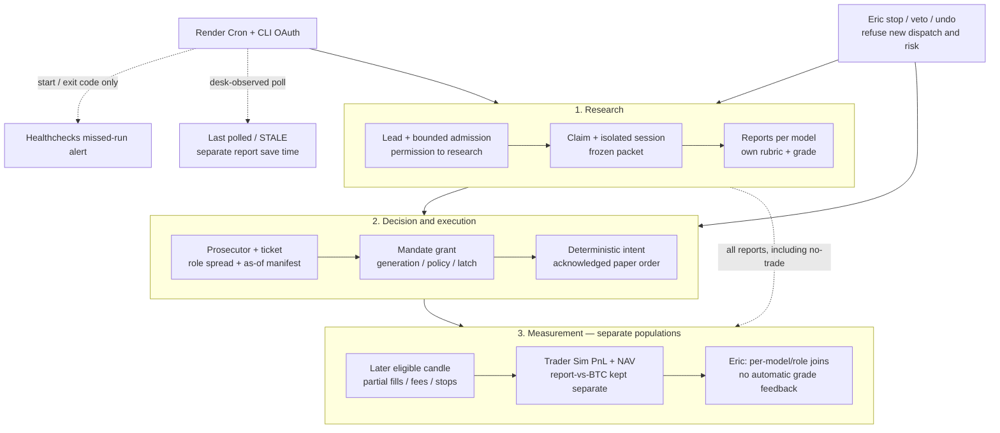

# PROPOSAL — Borrowed tools × Grades

**Status: PROPOSAL. Design only; no activation or implementation authorization.**

**Date:** 2026-11-02, America/New_York. **Author:** Codex.

**Code baseline:** `84cb28a2a863e77bdf6a450317cca5521f315399` (merged #130). Repository `file:line` citations below refer to that commit, including **committed** DESK_STATE.md, not the pre-existing uncommitted revision. Published vendor pages were read on this date; runtime behavior not exercised here is marked **UNVERIFIED**.

## 1. Recommendation and authority

Borrow hosting and failure notification; retain the desk's grade calculation, evidence, authority and paper accounting. Use fill and analytics ideas as specifications to verify, not replacement engines. Do not interpret a profitable selected paper trade as proof that every model whose report was attached made a profitable decision.

| Candidate | Verdict | Reason and boundary |
| --- | --- | --- |
| 1. Render Cron runner | **ADOPT, gated** | Removes the PC's availability from dispatch. **Reject an unchanged-command cutover:** credentials, Linux isolation, revision alignment and ephemeral answer recovery need proof first (§4). |
| 2. `setup-token` / `CLAUDE_CODE_OAUTH_TOKEN` | **ADOPT** | The official CLI supports unattended subscription authentication; the existing launcher preserves this variable and excludes API keys. Keep it off the desk service and out of model prompts (§5). |
| 3. Healthchecks + desk last-polled | **ADOPT** | Adds an independent missed-run signal and a separate desk-observed timestamp. Neither certifies grade quality, fill completion or current authority (§6). |
| 4. Freqtrade/Hummingbot fills | **PATTERN ONLY** | Most requested mechanics already exist. Verify and expose the actual assumptions, especially whole-position exits; do not import an engine or copy source (§7). |
| 5. QuantStats/Nautilus patterns | **PATTERN ONLY** | Add a small deterministic, read-only attribution projection; reuse the existing paper engine for replay. Period win rate is not trade hit rate (§8). |

All future actions remain paper-only, one supervised task/branch/PR, with `node dashboard/cli.js test` green and Eric merging. Models propose; deterministic code sizes and accounts (`docs/CONSTITUTION.md:11–31`). The one-sheet and network-failure tests are `docs/CONSTITUTION.md:73–77`. No server npm dependency is proposed (`package.json:1–20` has no dependencies; server policy is stated at `package.json:4`). No rejected candidate is reinstated: CCXT, Alpaca MCP, mcp-server-ccxt, Hyperliquid testnet, Alchemy MCP inside pilot sessions, claude-code-action, Temporal/Trigger.dev and whole-bot engines remain out of scope (Eric's task instruction, 2026-11-02).

**Canon conflict, not permission to invent policy.** The newer mandate and admission sections describe delegated paper grants and research intake (`DESK_STATE.md:10`, `DESK_STATE.md:58–82`, `DESK_STATE.md:322–394`). Older CLAUDE.md describes admission only by a click (`CLAUDE.md:36`), and the old invariant says only Eric's grants route (`DESK_STATE.md:465`). Task 2 should reconcile these dated statements, preserving earlier historical context. This proposal changes neither canon file. The dirty working-tree DESK_STATE.md and untracked audit/roadmap files are excluded from this PR.

## 2. What the grade pipeline actually does today

### 2.1 Three numerical meanings, no committee score

1. **Per-model research grade.** `rubrics.gradeAssessment` resolves the report's declared, hash-pinned rubric and calls `scoring.computeInvestmentGrade`; missing rubric or components withhold the grade. The computation weights components **within one assessment**, never providers against each other (`dashboard/core/rubrics.js:3–8`, `dashboard/core/rubrics.js:103–113`, `dashboard/core/scoring.js:2–8`). A grade range stays a range; coverage is not a substitute score (same citations).
2. **Researcher–Prosecutor spread.** Agent 1 is the current eligible **Claude** report selected by `tickets.researcherOf`, not whichever provider has the highest grade (`dashboard/core/tickets.js:248–270`). Agent 2 is a separate prosecution session; its `conviction_score` is its own value, not a second research rubric grade (`dashboard/core/tickets.js:532–546`, `dashboard/core/pilot-worker.js:141–186`). `saveTicketOnce` stores Researcher grade, Prosecutor conviction and `spread_points = gateGrade(researcher) - conviction`; `gateGrade` uses a range's low endpoint, not a midpoint (`dashboard/core/tickets.js:274–280`, `dashboard/core/tickets.js:1467–1497`). The spread is disagreement, not an average or a calibrated probability.
3. **Cross-provider research comparison.** `compare.latestByProvider` selects each provider's eligible report; `comparability` checks rubric/profile/horizon/dates. `compareProject` calculates each report's grade separately. Existing category spreads/medians are descriptive comparison fields, not mandate inputs (`dashboard/core/compare.js:24–32`, `dashboard/core/compare.js:49–100`, `dashboard/core/compare.js:130–154`, `dashboard/core/compare.js:313–377`). **PROPOSED display:** keep each model and scope visible; show a signed pairwise grade difference only for comparable point grades. For ranges show endpoints and explain that no point difference is available; do not manufacture midpoints. Label the role spread separately from a Claude–ChatGPT research difference.

### 2.2 Sequence and actual decision-makers

| Stage | Functions and current evidence | What acts on a grade? |
| --- | --- | --- |
| Scout lead → research admission | `lead-admission.plan` checks authority, ELIGIBLE leads, daily reservation, active pipeline and budgets; `candidateOf` checks identity/chain/routes/collisions. `reserve`/`sweep` delegate the existing admission path (`dashboard/core/lead-admission.js:268–360`, `dashboard/core/lead-admission.js:376–401`). | **No research grade exists yet and none is required here.** ELIGIBLE means eligible to research, not a trade grant (`dashboard/core/lead-admission.js:2–13`). Do not add grade-driven intake under this proposal. |
| Research generation → saved report | `pilot-worker.prepare` calls `research.createRun` for Claude, verifies the frozen prompt hash and binds one session; `complete` imports through `inbox.importContent` and verifies the run's completed job before releasing the claim (`dashboard/core/pilot-worker.js:124–164`, `dashboard/core/pilot-worker.js:195–214`). | The model emits component assessments; the desk calculates the grade. A draft/partial answer is not a verified current grade. |
| Grade → prosecution eligibility and sizing | `tickets.researcherOf`, `gateGrade`, `pregateReason`, `gate`, `saveTicketOnce` (`dashboard/core/tickets.js:250–280`, `dashboard/core/tickets.js:416–469`, `dashboard/core/tickets.js:510–520`, `dashboard/core/tickets.js:1383–1505`). | Agent 1's grade gates new risk. Agent 2 proposes a trade plan; deterministic sizing can cap it. Its conviction and spread remain separate. |
| Receipt → mandate grant | `mandateEligible`, `mandateSweep`, `decide`, `mandate-authority.prosecutionHoldOf` (`dashboard/core/tickets.js:2570–2604`, `dashboard/core/tickets.js:2607–2678`, `dashboard/core/tickets.js:1882–1916`, `dashboard/core/mandate-authority.js:188–240`). | Grade tier plus positive allowed risk, consistent prosecution, current exits/contracts, chain/pair support, zero decision history, caps and authority. A high grade alone cannot grant. Existing tiers: below 50 no grant; 50–<55 exploratory; ≥55 standard (`DESK_STATE.md:54–56`). No blend or performance weight. |
| Grant → intent → paper order | `trader-desk.intentIdOf`, `planOf`, `assess`, `step`; `paper-trader.reserveIntent`, `submitIntent` (`dashboard/core/trader-desk.js:119–129`, `dashboard/core/trader-desk.js:382–415`, `dashboard/core/trader-desk.js:494–659`, `dashboard/core/trader-desk.js:781–811`, `dashboard/core/paper-trader.js:747–810`, `dashboard/core/paper-trader.js:867–879`). | Deterministic risk checks and frozen grant/exit/venue inputs. No model chooses quantity. |
| Market evidence → fill/close | `trader-desk.applyHours` checks revocation with `revokeBefore`; `paper-trader.applyBar` applies causal closed-hour rules (`dashboard/core/trader-desk.js:818–881`, `dashboard/core/paper-trader.js:965–1031`). | Market evidence and engine rules, not the grade, determine whether and how much fills. |
| Outcome reads | `paper-trader.results`, adapter `trader-desk.view`; `report-outcomes.measure/byModel`; legacy `paper.book` (`dashboard/core/paper-trader.js:1077–1127`, `dashboard/core/trader-desk.js:683–727`, `dashboard/core/report-outcomes.js:108–229`, `dashboard/core/paper.js:375–409`). | Three different measurement populations; none automatically changes the grade. |

**Important existing separation.** Report outcomes measure each model's report against BTC at 30/60/90/120 days; they are price observations, not fee-paying fills. Their aggregate statistics require 20 measured reports per model/horizon and explicitly do not rank models; `byModel` does not itself stratify by rubric, regime or trading policy (`dashboard/core/report-outcomes.js:2–29`, `dashboard/core/report-outcomes.js:194–218`). The PM Cohort benchmark uses decision-time price readings and says its fees/slippage are unknown (`dashboard/core/paper.js:398`). Trader Sim has fee-bearing fills and a cash book (`dashboard/core/paper-trader.js:440–464`). Never present the PM benchmark as realistic Trader Sim PnL.

## 3. One-page grade lifecycle after the proposed changes

This diagram is a **proposed** architecture summary, not proof of deployment. Solid execution arrows retain the existing functions in §2; dashed arrows are observation/attribution, never grade or authority feedback.

The stop arrow means **refuse new dispatches and opening risk**, not kill protective exits or discard an answer already generated. Current claim/bind only check global pause, while `autonomyOf` governs the project latch elsewhere (`dashboard/core/pilot-claims.js:131–139`, `dashboard/core/pilot-claims.js:205–251`, `dashboard/core/mandate-authority.js:26–41`, `dashboard/core/tickets.js:1893–1896`). Fix Task 1 before off-PC activation. Risk-reducing work precedes new openings (`dashboard/core/trader-desk.js:793–806`).

## 4. Candidate 1 — Render Cron runner

**a. Touchpoints today.** `pilot.runAll` pre-polls, applies session/max-agent limits and invokes `runOnline`; the worker then runs the research/ticket chain in §2. It does **not** run the hosted `mandateSweep`, book or outcome job itself (`dashboard/scripts/pilot.js:863–967`, `dashboard/core/pilot-worker.js:124–235`, `dashboard/core/tickets.js:2607–2613`). Lead admission is still the existing desk job, not a new cron feature (`dashboard/core/lead-admission.js:2–13`).

**Verified borrowing constraint.** Render cron schedules are UTC, cannot attach/access persistent disks, allow one active run **per cron service**, delay a scheduled run behind an active one, cancel the active run on a manual trigger, and stop runs after 12 hours. A build does not replace an in-flight run. These guarantees do not cover a second cron service or Eric's PC ([Render Cron Jobs](https://render.com/docs/cronjobs)).

**b. Grade meaning/time/actor.** PROPOSED: same prompts, rubric, provider selection, model/effort and gates; only execution host and potential production times change. Pin/review Node and Claude CLI versions and explicit model/effort; do not silently replace Eric's PC settings with Linux defaults. Today `sessionChoice` reads flags/env/local settings (`dashboard/scripts/pilot.js:176–208`). Linux readiness with those exact binaries is **UNVERIFIED**. Cron may produce and save grades while the UI shows STALE: an in-flight session can outlast the freshness interval; another authenticated research route can also save reports. The independent UI contract is §6, not a claim that every saved report came from this cron.

**c. Outcome attachment.** Preserve attempt ID, run/report/prompt hash and runner revision for §9's as-of manifest; the runner never assigns realized PnL to a model or computes a new grade. Canonical worker completion already checks the claimed prompt and completed report/receipt (`dashboard/core/pilot-worker.js:195–235`).

**d. Fill realism.** No price, fee or fill changes. The hosted engine remains the source of the §10 outcomes; moving dispatch must not backdate an intent to a signal candle.

**e. Failure/guard.** F01–F08 in §11 are activation blockers. In particular, current bearer readers expect `~/.cryptoresearch/secrets.json`, and current unsuccessful completion writes pending answer text locally (`dashboard/scripts/pilot.js:640–647`, `dashboard/scripts/pilot.js:704–775`, `dashboard/scripts/pilot.js:831–837`). **An unchanged command on an ephemeral cron is not ready.**

PROPOSED minimum integration: supply poll/worker secrets through runner-only environment reads, with no values in argv/logs or child environment; retain the two existing bearer scopes. At cutover disable the PC pilot task, inspect unresolved attempts, and run one cron service with `--pilot-all --desk=online --max-agents=1` (not two competing schedulers). The hosted desk remains the sole owner of record files and paper execution.

**Answer durability decision:** a complete response accepted by the existing worker is durable on the desk. Existing bounded retry helps only while the runner and answer survive (`dashboard/scripts/pilot.js:678–700`). If the desk is unreachable until cron termination, a local pending file is not durable recovery. PROPOSED: do not claim lossless operation or add a blob/database vendor. Gate recurring cutover on an outage/termination drill and Eric's choice Q1. A smallest follow-up could checkpoint answer drafts into the **existing** desk draft records through a narrowly scoped worker operation; that improves recoverability while connected but cannot solve a simultaneous network outage and runner loss. It must not silently authorize a new session or become another queue. If durable offline recovery is required, **REJECT cron for that requirement** and return a separate host comparison; a disk-capable runner is a different candidate, not an unannounced substitution.

**f. One-sheet cost.** +1 managed cron compute service, +0 vendor organizations if reusing Render, +0 new desk authority, +0 new bearer types; existing poll/worker tokens move to it. Reuse existing claim states. One deployment revision field is provenance, not permission. Replaces one PC pilot task and its wake/task-wrapper dependency; net benefit is conditional on Q1. Do not retain both as automatic failover: that adds more concurrency complexity than it removes.

## 5. Candidate 2 — CLI subscription token

**a. Touchpoints.** `launchEnv` preserves `CLAUDE_CODE_OAUTH_TOKEN`; `launchArgs` supplies a web-only, no-MCP command line; `makeLauncher` checks the installed CLI and performs a local stand-in tool probe before claims (`dashboard/scripts/pilot.js:125–173`, `dashboard/scripts/pilot.js:196–208`, `dashboard/scripts/pilot.js:434–464`). The credential enables the sessions that produce the §2 report and ticket; it changes none of the other pipeline stages.

**Verified external contract.** `claude setup-token` creates a one-year subscription OAuth token for unattended CLI use; it is supplied as `CLAUDE_CODE_OAUTH_TOKEN`. Bare mode does not read it. The token can make model requests but cannot fetch claude.ai connectors; locally configured MCP still requires explicit exclusion ([Claude authentication](https://code.claude.com/docs/en/authentication#generate-a-long-lived-token)). No token was generated or inspected for this design.

**b. Meaning/time/actor.** PROPOSED: keep research role, model/effort and grading definitions stable. Token expiry can prevent the next grade, not make its value zero. An old eligible report keeps its original save/analysis dates and research-staleness indicator. A successful poll followed by failed model authentication must show fresh polling **and failed dispatch**, not a healthy research pipeline (current poll payload and runner outcomes: `dashboard/core/pilot-poll.js:33–65`, `dashboard/scripts/pilot.js:935–963`).

**c. Attribution.** Record model ID, role, prompt/rubric and runner build, never token bytes or token-derived identifiers in §9. Renewing credentials is not a new investment strategy or a reason to rewrite grade history.

**d. Realism.** No effect on execution assumptions or outcome formulas; use §10. No paid session is generated merely to prove credentials during this proposal.

**e. Failure/guard.** F09–F12. PROPOSED: Eric generates the token interactively and stores it only in the cron service's secret environment, not an environment group shared with the desk. The CLI process necessarily receives it; “cron only” means no desk, GitHub, browser, prompts or unrelated runtime receives it. The runner's child-env allowlist drops desk bearers and heartbeat URL. Verify absent API-key fallback, real authenticated startup/tool restrictions, and model identity before cutover; the existing placeholder probe alone does not prove subscription authentication or connector exclusion under that login (`dashboard/scripts/pilot.js:390–406`, `DESK_STATE.md:180`). Record issuance/expected renewal date without storing secrets in records; alert before expected expiry and fail closed on refusal. No automatic login loop, no `--bare`, no provider switch.

**f. Cost.** +1 long-lived model credential on the runner, +1 renewal date; +0 new vendor, grading state, order state or authority. Replaces reliance on the PC's cached interactive login. Acceptable one-sheet cost if renewal is visible.

## 6. Candidate 3 — Two Healthchecks pings and desk-observed liveness

**a. Touchpoints.** Wrap `pilot.runAll` start/final exit; separately observe successful authenticated queue polls on the desk. Current `runAll` logs locally, and `pilot-poll.makePilotPollRoute` is expressly read-only and keeps only in-memory rate buckets. No durable last-polled timestamp is implemented by that code (`dashboard/scripts/pilot.js:868–878`, `dashboard/core/pilot-poll.js:2–15`, `dashboard/core/pilot-poll.js:80–109`). A new telemetry write must therefore be described and tested, not claimed to exist.

**Verified external contract.** Healthchecks accepts `/start` and a final `/{exit-status}`: zero means success, nonzero failure. Missing completion after the configured grace interval is a missed-run signal; matching UUID `rid` correlates start/end, but monitoring concurrent runs has limits ([failures](https://healthchecks.io/docs/signaling_failures/), [runtime and run IDs](https://healthchecks.io/docs/measuring_script_run_time/)).

**b. PROPOSED behavior and UI contract.** Two bounded `fetch` attempts per actual invocation: `/start?rid=<opaque UUID>`, then `/<0|1|2|3>?rid=...` on a settled exit path. No body, project names, grade, report text, error logs or desk bearer to Healthchecks; URL is a secret. Use built-in fetch with a short fixed timeout and no retry cascade. Ping failure never alters the runner's exit code, releases a claim, arms a mandate or cancels a stop. SIGKILL cannot promise a final ping; absence is why the dead-man's switch exists. Existing exit 0 includes paused/no-work/locally-locked outcomes; exit 3 means reconcile is needed, not loss or permission to repeat (`dashboard/scripts/pilot.js:880–908`, `dashboard/scripts/pilot.js:958–969`). A green external check means a process exited zero, not “a grade was produced.”

PROPOSED desk telemetry: keep existing GET polling read-only. Add **one narrow `poll` operation under the existing worker bearer** for the production runner. It computes the same bounded queue snapshot and, only when that succeeds, records server-observed `last_polled_at` with an allowed runner ID, opaque invocation ID and runner revision. Its POST response carries the queue snapshot; failed authentication or snapshot read cannot advance the timestamp. It authorizes no session, settings change or reconciliation. This means “the desk accepted a valid poll,” not “the runner received the response”; a lost response must leave that distinction explicit. Retain the read-only poll bearer/GET for existing diagnostic/dry-run clients; those reads do not certify production-runner contact. Apply the existing poll limit to the new operation as well. Store one bounded current runner record, not another work queue or scheduler. A signed-in UI read writes nothing. This worker operation is **PROPOSED**, not an existing capability (`dashboard/core/pilot-worker.js:43–46`); no receipt/ack protocol or extra token is needed.

PROPOSED display separates these facts:

| Fact | Display and consequence |
| --- | --- |
| Schedule intentionally disabled | “Runner disabled”; show last polled if known, not an overdue-failure claim. Keep mandate/admission states separate. |
| Timestamp absent/unreadable, no verified poll | “— · No verified runner poll” / reason. Never infer a start time from deploy or a page refresh. |
| Last poll within expected interval | “Last polled <server time>”; this proves contact only. Show latest known run outcome/claim separately. |
| Last poll overdue | “STALE · Last polled <time>”; show age and expected interval/grace, with “An earlier session may still be running.” |
| Grade saved while runner STALE | Show both: “Claude report saved <time>” and “Runner STALE.” Do not suppress, zero, freshen or relabel the report. Its provenance/grade validity still decides eligibility. |
| Healthchecks down but desk polls recent | “Runner last polled <time>”; external alert delivery is unavailable/UNVERIFIED. Never call it a trading failure. |

For an hourly proposed schedule, a **proposed**, Eric-reviewed overdue threshold is 90 minutes since the last desk-accepted production poll; do not represent it as canon. Because long sessions and delayed cron ticks can exceed it, STALE means overdue observation, not dead. Show dispatched attempt ID/started/expiry and last known result; do not add a grade-invalidating liveness gate. Expected schedule/grace belongs in one settings record, not hard-coded independently in UI and cron. Task 3 includes signed-in off-only mandate/admission/project-stop controls and explicit readback, reusing Settings/autonomy operations (`dashboard/server.js:1277–1298`, `DESK_STATE.md:396–431`). Reconcile remains evidence-based, signed in and explicit, never a blind “retry” button.

**c/d. Attribution and fills.** Liveness is operational metadata only. It neither enters the grade rubric nor determines signal/fill prices or model outcome credit; §§9–10 apply unchanged. Reports saved by API/manual routes can still appear; always show actual channel/role/run provenance.

**e. Failure/guard.** F13–F17. A pause should still permit zero-cost polling; stopping new sessions must not erase evidence that the runner can reach the desk. Failed production polling leaves last-polled unchanged/possibly STALE, while verified grades remain readable. A POST response lost after its telemetry save can leave fresh contact but an unknown runner result; do not infer session success. No third-party ping controls authority.

**f. Cost.** +1 notification vendor, +1 secret ping URL, +1 bounded runner-observation record, +1 worker operation. Derived UI labels are disabled/recent/STALE/unknown, not order states. **Complexity decision:** the explicit POST is justified because GET must stay read-only and contact must be desk-observed. Reject any receipt/ack handshake, wider telemetry framework, per-project heartbeat fleet, status-to-trade gate, or auto-recovery service. Start/end run ID is opaque; no durable lease negotiation is added.

## 7. Candidate 4 — Fill patterns, not borrowed engines

**a. Touchpoints.** Existing `paper-trader.applyBar` and `applyEvent` already implement fills, fees, partial opening fills, stops and exits. `trader-desk.applyHours` feeds them and checks grant revocation before each hour (`dashboard/core/paper-trader.js:421–464`, `dashboard/core/paper-trader.js:965–1031`, `dashboard/core/trader-desk.js:818–881`). This is downstream of all grades; `paper.js` is a different PM benchmark, not the place to replace Trader Sim fills (§2).

**External verification changes the candidate's premise.** Freqtrade's documented backtest assumes no slippage for in-range requested fills; it is not evidence that importing it improves realism. Hummingbot's paper mode illustrates a paper/live separation, not a verified model of this desk's AMM exits ([Freqtrade assumptions](https://www.freqtrade.io/en/stable/backtesting/#assumptions-made-by-backtesting), [Hummingbot paper trade](https://hummingbot.org/client/global-configs/paper-trade/)). Freqtrade's license is GPLv3; copy no code ([license](https://github.com/freqtrade/freqtrade/blob/develop/LICENSE)). Borrow questions/behavioral tests, not source or third-party accounting definitions.

**b. Grade meaning/time/actor.** PROPOSED: no grade recalculation. If a later approved fill policy worsens execution, version the assumption set, present cohorts separately and explain the implementation drag. Do not downgrade a historical grade to compensate or silently rerun history under nicer assumptions. Existing rules are not empirical proof of executable liquidity.

**c/d. Outcome and realism contract.** §9 links the exact pre-trade model/role judgments to §10's actual simulated fill events. Show entry VWAP, executed quantity, fees, remaining quantity, simulated exit and net PnL, alongside signal/reference price as a diagnostic only. Do not award profit on unfilled notional. These are **quantity-weighted fills of one order**, never an average of model grades.

| Requested pattern | Current implementation and limitation | PROPOSED action |
| --- | --- | --- |
| Fee-bearing fills | Order reservation freezes maker/taker rate, lot and stop slippage; fills/exits record fees; unknown fees refuse (`dashboard/core/paper-trader.js:771–775`, `dashboard/core/paper-trader.js:796–806`, `dashboard/core/paper-trader.js:988–991`, `dashboard/core/paper-trader.js:1023–1027`). | Expose frozen rates and actual charged amounts; distinguish network costs/tax that are evidenced vs unmodeled. Do not deduct an exit quote's already-included cost twice. |
| Partial fills | Opening quantity limited by `FILL_SHARE_MAX` and lot-rounded candle volume; leftovers stay PARTIAL (`dashboard/core/paper-trader.js:1013–1027`). | Preserve per-fill events and order-level completion. Exits currently fill whole, a stated simplification (`dashboard/core/paper-trader.js:92–94`); mark it explicitly. **No claim of partial-exit realism.** |
| Causal next candle | Only closed bars; bar start must be ≥ the order's sent time; same/different repeated bars are respectively idempotent/refused (`dashboard/core/paper-trader.js:968–986`). | Preserve the stronger exact rule, not a vague “next candle.” An order sent exactly on a new hour may use that hour; one sent mid-hour cannot use its earlier range. Signal candle is not retrospectively eligible. |
| Slippage and ambiguity | Stop slippage and adverse opening gaps; stop before target; fill-hour stop but no fill-hour target (`dashboard/core/paper-trader.js:987–1029`). | Label parameter assumptions, not observed queue/depth. Limit entry uses min(open, limit), not a generic adverse-slippage deduction. A changed fill mechanism needs its own future core review. |
| Missing data | Exposed pairs refuse missing-hour gaps; stale marks make NAV/drawdown unknown (`dashboard/core/paper-trader.js:977–978`, `dashboard/core/paper-trader.js:1083–1101`). | “— · Missing hour/mark”; never synthesize zero volume, signal-price fills or a flat equity curve to complete a scorecard. |

**e. Failure/guard.** F18–F21 and §10. Current executable tests already cover fees, partials, stops, causal ambiguity and idempotency (`dashboard/tests/paper-trader.test.js:85–203`, `dashboard/tests/paper-trader.test.js:424–445`, `dashboard/tests/trader-desk.test.js:119–140`). Use them; identify a demonstrated missing assumption before proposing engine edits.

**f. Cost.** +0 runtime vendors/tokens, +0 execution states. Add an assumption/version reference in attribution metadata and visibility in existing Outcomes. Keep all four protected files untouched in this design and its initial implementation slices. **REJECT** a whole engine, new broker/exchange integration, GPL code translation, or a parallel shadow fill engine: more complexity and conflicting truth sources than benefit.

## 8. Candidate 5 — Small deterministic outcome metrics and same-engine replay

**a. Touchpoints.** `paper-trader.results` already returns realized PnL, fees, open/closed positions, hourly NAV and drawdowns. `report-outcomes.measure/byModel` separately measures each report (`dashboard/core/paper-trader.js:1077–1127`, `dashboard/core/report-outcomes.js:108–218`). `decimal.js` provides BigInt fixed-point arithmetic with 18 decimal places and rejects excess precision by default (`dashboard/core/decimal.js:2–8`, `dashboard/core/decimal.js:18–57`). These are the existing building blocks, not a reason to install Python or another ledger.

**External pattern.** QuantStats operates on return periods; its win rate is the share of positive periods, which differs from closed-trade wins. Nautilus shares core code across environments but explicitly says this cannot make different timing, inputs and transport produce identical outcomes ([QuantStats metric semantics](https://github.com/ranaroussi/quantstats#important-period-based-vs-trade-based-metrics), [Nautilus design principles](https://nautilustrader.io/docs/latest/developer_guide/design_principles/#backtest-and-live-behavior)). Borrow those distinctions; do not import either dependency or recreate their framework.

**b. Grade meaning/actor.** PROPOSED: an Eric-facing outcome inspection, not a “corrected grade,” probability calibration, model ranking or adaptive mandate. The North Star includes Paper Book outcomes, and the existing report-outcomes contract explicitly disclaims accuracy/ranking; the reviewed canon supplies no rule translating grade 70 into a required PnL/hit rate or winning model (`DESK_STATE.md:14–17`, `dashboard/core/report-outcomes.js:216–218`). That absence is a bounded review finding, not proof that no such owner decision exists elsewhere. Q2–Q4 require Eric's judgment before any such interpretation. No automatic rubric weights, thresholds, admission or mandate changes.

**c. Grade-to-outcome loop.** Use §9's model/role manifest. A read-only projection groups exact completed trades by provider/model version, role, grade/range status, rubric/profile/prompt, horizon and fill-policy version, with mandate generation available as a filter. One trade can be **associated** with several independent pre-trade reports; its PnL is recorded once in the book. Associated rows must not be summed across models or called independent model strategies. A report/conviction is not a probability; no Brier/log-loss or probability calibration is proposed without a defined forecast.

PROPOSED initial metrics are decimal net realized PnL, known closed-position counts, closed-trade hit rate, and peak-to-trough drawdown from valid NAV. Implement one pure aggregator outside protected core, using `decimal.js`, with formulas in §10. No Sharpe/CAGR/annualization by default: frequency, risk-free rate and sampling policy would be new decisions. Research-vs-BTC stays alongside execution attribution to include untraded/rejected reports and expose selection bias (§2).

**Same code means:** replay the same ordered recorded bars, funding, intents, decisions and control events in a fictional workspace through the existing adapter/engine entry points; compare event-derived results with continuous paper operation. Inject the same clock and config/engine revision. Do not re-run the LLM with later knowledge or query today's settings. The engine already supports journal replay and time/order checks (`dashboard/core/paper-trader.js:395–401`, `dashboard/core/paper-trader.js:690–711`, `dashboard/core/paper-trader.js:965–978`); complete cross-environment equivalence is **UNVERIFIED** until the proposed test. Never run replay against the production workspace or call a real venue.

**d. Fill basis.** The aggregator consumes actual simulated fill/exit fees and quantities, not report/reference returns. Execution assumptions stay attached; an unknown component makes only its dependent metric unknown (§10), not a fabricated 0 or silent exclusion.

**e. Failure/guard.** F22–F28. Critical existing warning: `report-outcomes.reportsOf` selects the latest save/revision for each run/provider while `startOf` can retain the original packet's T0 (`dashboard/core/report-outcomes.js:78–105`). That descriptive current-report view must **not** be reused as an as-of trading-performance cohort: it can attach a later revision to an earlier start. Preserve that view's stated meaning and build the temporal join separately.

**f. Cost.** +0 vendor/token, +0 execution states; +1 pure analytics projection and +1 versioned attribution-manifest schema within existing append-only records. Derived states are measured/pending/unavailable with reason. **REJECT** a second cash ledger, scoring engine, leaderboard, automatic self-training service or per-model shadow capital book without new Eric-approved requirements.

## 9. Minimum grade-to-fill lineage and leakage boundary — PROPOSED

### 9.1 What “earning” may and may not mean

The desk can show **“Trades associated with Claude research grade 60–69 under policy X”**, separately from **“Prosecutor conviction 30–39”** and **“ChatGPT research grade 70–79 present before the decision.”** It cannot honestly show “ChatGPT earned this PnL” if ChatGPT did not control the trade. Agent 2 intentionally sees Agent 1's frozen report; it is an adversarial second stage, not independent initial research (`dashboard/core/pilot-worker.js:166–186`, `DESK_STATE.md:29–39`). Keep model identity **and role** in every grouping. Separate Claude Researcher and Claude Prosecutor even when the provider string matches.

PROPOSED two linked views:

- **All-report evaluation:** retain existing per-model horizon/BTC observations, including no-trade cases; show unavailable/maturing counts. They answer what happened after a report, without fees or a trading-policy claim (`dashboard/core/report-outcomes.js:108–192`).
- **Executed-policy attribution:** one actual Trader Sim trade and its decision-time judgment vector; show net simulated economics and selection reason. No fill means “Not traded,” not a zero-return win/loss. This answers how the desk's selected decisions performed, not which provider would independently have made the most money.

Keep grade bins, endpoint interpretation, sample threshold and any claim of usefulness **PROPOSED / awaiting Q2–Q4**. Existing 20-report research threshold is not automatically a 20-trade mandate. Show counts and individual cases immediately; withhold model-level effectiveness conclusions until Eric approves the cohort definition. No provider sorted by return.

### 9.2 Logical record required for every fill

The following is the **minimum portable analytical record**, not a request to duplicate the accounting journal. Existing immutable references may supply values on read. Freeze a decision-time manifest in the existing decision operation for future trades; a missing/ambiguous manifest makes attribution unavailable, never rewrites a grade or changes a trade. The current book's `reserved` event already keeps intent, grant, exit and venue; fill events keep execution economics, but are not complete all-model attribution records (`dashboard/core/paper-trader.js:796–806`, `dashboard/core/paper-trader.js:1027`).

| Group | Required data / reference and semantics |
| --- | --- |
| Unique source event | Desk/book identity, paper mode, journal version, `seq`, event hash and journal-head reference; dedup key `(book, seq, hash)`. Existing journal events have sequence, event time and previous hash (`dashboard/core/paper-trader.js:698–711`). A conflicting hash is integrity failure, not another fill. |
| Asset and policy lineage | Frozen project identity (chain/contract/CoinGecko ID and hash), admission ID + eligibility receipt + admission authority generation/hash **if applicable**, run ID, ticket ID, receipt ID/text/packet hashes, decision ID/time/actor, intent ID/hash, client_order_id, position_id. An explicit manual-intake origin is valid; absent delegated lineage is not fabricated. Admission and mandate authority stay separate (`dashboard/core/lead-admission.js:15–23`). |
| Mandate lineage | For a mandate grant: version, generation, armed_at, policy/settings SHA-256, expiry, tier and exact grade used; frozen decision hash. For a human grant: actor and explicit `mandate: not_applicable`, not generation 0. The decision/authority binding exists today (`dashboard/core/tickets.js:1882–1916`, `dashboard/core/mandate-authority.js:6–24`). Read original authority, not the current settings after re-arm. |
| Each research provider, separately | Provider + exact model version + role `researcher`; report ID/original hash, saved/analysis time, run/packet hash and capture time, prompt/execution-note/profile/rubric versions and hashes, grade status/value/low/high/coverage/reason. Include all eligible, scope-matching reports actually available **at or before decision time**; missing model = null + reason. Pin exact IDs before the outcome; never late-fill with a future report, excluded report or newer revision. Preserve later corrections as linked annotations. |
| Prosecutor and spread | Separate model/role, ticket/receipt/prompt hashes, conviction status/value, verdict/critical findings, proposal/stop/target and timing; frozen `agent_disagreement` and its Researcher-low-end basis. Cross-provider comparisons are a separate typed field with comparability status/reason. No generic unlabeled `score` or `spread`. |
| Execution timing/economics | Signal/reference price/time for diagnostics; decision, intent, sent and acknowledgement times; fill event time **and candle interval**; side, requested/executed/cumulative/remaining quantity, fill price, notional, fee amount/currency/rate/kind, entry/exit link and exit reason. Decimal strings, explicit units; quantity and cash reference the canonical book, not a recomputation from signal price. |
| Fill assumptions and input provenance | Engine commit/version; venue/rules hash, lot/tick precision if modeled, maker/taker fees, stop-slippage bps, volume-share cap, causal eligibility and intrabar priority, whole-exit simplification, network fee/tax modeled/unknown, candle source/pool/chain/timezone and exact input hashes/coverage. Execution policy changes create a new assumption version, never a historical overwrite. |
| Metric provenance | Attribution-schema/metric-definition version, cutoff/as-of, funding/cash-flow events, valuation input references and missing intervals, position closed/open/pending state, measured/unavailable reasons. Retain no-trade/held/cancelled cases in the linked denominator registry even though they have no fill row. |

**Availability cutoff is server save/decision time, not model `as_of`.** The ticket importer can clamp a model's future `as_of` while preserving both written and recorded times (`dashboard/core/tickets.js:1383–1456`, `dashboard/tests/ticket-as-of-skew.test.js:61–126`). Keep those fields; a claimed earlier analysis time does not make a late report available to an earlier decision.

### 9.3 No leakage, including a model's own historical evaluation

PROPOSED: analytics are for Eric's signed-in Outcomes view, not research packets, prompts, model-readable tools, defaults or automatic grading instructions. Preserve the packet allowlist: today research excludes holdings, journal and other models' reports/scores (`dashboard/core/research.js:874–909`). Explicitly extend tests to exclude **all own-model historical grades, outcome summaries, PnL, bins and performance labels**. The existing exclusion statement alone does not prove that future analytics are excluded. Do not send a model its evaluation score while asking it to grade; its newly written component scores are naturally its own output.

Test with unmistakable canary strings inserted into an own-model evaluation record and another model's grade: neither initial research packet/prompt may contain them. Prosecutor prompts may contain the **current frozen Agent 1 report**, as required by the role, but not Agent 2's historical performance or the joined outcome view. Web-only tools/no desk bearer prevent an intentional desk-tool backchannel (`dashboard/scripts/pilot.js:125–173`, `dashboard/scripts/pilot.js:196–208`); keep Outcomes authenticated and out of public model context. External prior knowledge cannot be completely excluded: do not claim a universal blind experiment. Archive any later Eric-approved post-mortem as a separate stage; it never replaces an original assessment or silently enters the next initial prompt.

## 10. Metrics, fill realism and unknowns — PROPOSED definitions for Eric

These are **proposed measurement definitions**, not existing grade-success requirements. Use decimal strings/BigInt operations from `decimal.js`; do not change that module. Round only for display, state rounding/version in exports.

- **Closed-trade net paper PnL:** sum executed exit proceeds minus executed entry notional minus entry and exit fees. Add other execution costs only when separately modeled and evidenced; do not charge slippage again if already reflected in the fill price. Current replay subtracts entry cost including its fee and exit fee (`dashboard/core/paper-trader.js:440–464`). Fully closed positions, not each partial fill, are the trade-count unit.
- **Closed-trade hit rate:** number of eligible closed positions with **net PnL > 0** divided by all eligible closed positions with known net PnL; known break-even positions remain in the denominator and are separately counted. Open/held/unfilled cases are separately counted, not losses or wins. If any candidate closed position has incomplete economics, display the known-subset numerator/denominator and incomplete count; whole-cohort rate is “— · Incomplete closed-trade costs.” With no closed trades: “— · No closed trades,” not 0%.
- **Maximum drawdown:** largest `(prior NAV peak − current NAV) / prior NAV peak` on a chosen, declared hourly equity series with positive peak. Existing results expose hourly NAV and absolute drawdown; do not rename absolute dollars as percent (`dashboard/core/paper-trader.js:1095–1124`). Missing required marks or unresolved settlement makes full-window drawdown “—” with the gap/window. Funding/cash injections are not investment returns: segment at funding/flow boundaries or compute an approved cash-flow-adjusted series. Initially show book-wide drawdown; do not duplicate full book drawdown on every model/grade-bin row. A bin's capital allocation/equity curve is undefined without a separately approved method (Q3).
- **Period win rate:** if later requested, count positive **declared return periods**, with period size and cash-flow policy. It is never labeled trade hit rate (QuantStats distinction, §8).

**Illustrative fixture, not observed trade.** An order signals at $10 for 100 units; only 40 execute at $10.20, entry fee $0.408; those 40 close at $10.80, exit fee $0.432. Net = `$432 − $408 − $0.408 − $0.432 = $23.16`. The signal-price/full-size result `$80` is not the execution outcome. The remaining 60 earn nothing because they never filled; show their cancellation/expiry. These are generic hypothetical fill events to test attribution, **not** a claim that the current limit engine fills above a $10 limit. For the actual engine, use only prices its limit/order rules can emit (§7). If its $0.432 exit fee is missing, show recorded proceeds and entry cost but net PnL **“— · Exit fee unknown.”** Do not substitute an estimated cost silently or include it as a known hit.

Realistic fills can reduce PnL, leave no fill, or cause a stop loss even while the asset later rises. Show the unchanged research grade/BTC observation beside the actual execution result and assumption version. This separates research direction, prosecution/stop geometry, execution drag and mandate selection without claiming to causally apportion each dollar. With a no-trade hold, the live-fill milestone stays unproven (`docs/engineering/BOUNDED_PAPER_READINESS.md:683–713`).

## 11. New or newly exposed false/stuck/stall states and guards

All guards in this table are **PROPOSED acceptance requirements**, not claims of implementation. Current-code citations identify the boundary being extended. This enumerates the design's identified failure classes; provider-specific Linux/runtime behavior beyond tested cases remains **UNVERIFIED**.

| ID / candidate | False state, stuck state or stall | Guard and proof obligation |
| --- | --- | --- |
| F01 / 1 | Two cron services, PC overlap or manual run duplicates work | One production scheduler at cutover; authoritative claim/prepare/bind wins, never local lock alone. Cross-host double-prepare test; limits remain per invocation unless server-enforced (`dashboard/core/pilot-claims.js:131–174`, `dashboard/core/pilot-worker.js:124–186`). |
| F02 / 1 | Manual trigger cancels a paid in-flight run; later run assumes nothing happened | No manual trigger while active; inspect claim/session first. Termination leaves dispatched attempt for reconciliation; no TTL-based replay. Render behavior: §4 source. |
| F03 / 1 | Ephemeral pending file/answer disappears; paid session has no grade | Q1 cutover gate and outage/kill drill; distinguish saved, refused-with-draft, and unavailable answer. Preserve unknown claim; no new paid session until Eric reconciles (`dashboard/scripts/pilot.js:704–775`). |
| F04 / 1 | Linux CLI missing, isolation flags changed, hostile config, native resource failure | Pin Node/CLI image, bounded startup, exact help/probe + authenticated smoke evidence before activation; refuse before claim on failed boundary (`dashboard/scripts/pilot.js:434–464`). Never remove flags to make cron run. |
| F05 / 1 | Deployed desk and in-flight runner use incompatible builds/schema | Verify deployment SHA/API format, record runner SHA; stop new dispatch on unsupported contract. Never kill an old attempt just to make SHAs match; complete/reconcile its exact prompt first (`dashboard/scripts/pilot.js:653–667`, `dashboard/core/pilot-worker.js:195–199`). |
| F06 / 1 | UTC/DST/day-cap mismatch or long run delays next cron | UTC schedule; New York caps stay server-derived. No catch-up burst or quota reset; test fall-back/spring-forward and delayed schedule (`dashboard/core/lead-admission.js:306–326`). |
| F07 / 1 | Whole desk unreachable; cron replays after timeout | Bounded call/backoff, nonzero/needs-reconcile outcome; uncertain dispatch remains claimed. Never timer-release UNKNOWN work (`dashboard/scripts/pilot.js:653–700`, `docs/CONSTITUTION.md:37–38`). |
| F08 / 1 | High grade saves after stop; new grants/buys resume | Recheck project latch at claim/prepare/assert/bind and execution boundaries; allow preserving completed answers without granting. Existing execution cancellation remains (`dashboard/core/trader-desk.js:845–881`). |
| F09 / 2 | OAuth expires/revoked, quota exhausted: poll looks healthy but no research | Show last dispatch failure separately; explicit expiry reminder, no automatic credential/provider change. Failed session stays charged as appropriate; previous grade keeps its age (§5). |
| F10 / 2 | API key/profile precedence silently changes billing/model | Clean runner/child env and pinned launch config, auth-route validation; no shared API key or fallback (`dashboard/scripts/pilot.js:125–173`). |
| F11 / 2 | OAuth/worker token or heartbeat URL leaks via logs, prompt or child | Secret names only; redact errors/URLs; allowlist child env; negative sentinel tests for each credential. OAuth stays available to CLI process, not model context. |
| F12 / 2 | Token rotation redeploy interrupts a session or resurrects old claims | Wait for completion/reconcile before runner replacement; rotation never changes attempt, authority generation or research rubric. Test retained claim across restart. |
| F13 / 3 | Heartbeat vendor outage stalls grading or triggers trade controls | Two short best-effort pings, no vendor dependency in work/authority path; original exit code preserved; mock timeout/5xx. |
| F14 / 3 | Zero exit for paused/no-work/locked run shown as “grades healthy” | External check means process result only; desk shows reason, report timestamps, claim and last outcome separately (`dashboard/scripts/pilot.js:880–908`). |
| F15 / 3 | Page visit, forged clock, wrong runner ID or failed poll falsely freshens runner | Narrow worker POST performs the actual queue read before recording server time; reject arbitrary timestamps/unknown runner IDs; GET/UI reads remain read-only; corrupt record unknown. Repeat genuine polls are contact, never evidence of completion or permission to grant. |
| F16 / 3 | Long session or delayed cron shows STALE while grade is saved | STALE = overdue contact only; show last verified report save independently and active attempt. Never discard a valid completion based on heartbeat alone. |
| F17 / 3 | Crash misses final ping; start/end paired with wrong run; alerts flood after disable | Opaque UUID rid; single service; grace covers expected duration; disabled schedule explicitly labeled. No infinite ping retries; no claim reset. Healthchecks concurrency caveat: §6 source. |
| F18 / 4 | Signal candle/lookahead or full requested quantity creates fictional profit | Use journal fills and sent/bar causality, executed quantity only; fixture with mid-hour sent time, partial quantity, fees and adverse stop (§7). |
| F19 / 4 | New fill assumptions silently reprice old trades or double-charge exit quote costs | Freeze engine/assumption/input hashes; keep original cohort. Deterministic accounting matches journal exactly; fee/slippage already in fills not deducted twice. |
| F20 / 4 | Missing volume/mark/fee treated as zero, flat return or certain execution | Missing-dependent metric null + reason; no synthetic bars; preserve GAP and settlement states (`dashboard/core/paper-trader.js:977–978`, `dashboard/core/paper-trader.js:1083–1101`). |
| F21 / 4 | Whole exits look like verified partial-exit/AMM liquidity realism | Expose “whole simulated exit” assumption and evidence coverage. No whole-engine import; any changed protected-core behavior requires a separately approved task. |
| F22 / 5 | Later revision/current “latest” grade attributed to an old fill | Pin as-of IDs/hashes in decision manifest; never current selector for historical attribution; new revision annotation only (`dashboard/core/report-outcomes.js:78–105`). |
| F23 / 5 | Same ticker, report, role or model version incorrectly joined | Exact frozen project/run/receipt/order/position IDs and identity hash, role+provider+version, comparability checks; ambiguity unavailable, never fuzzy join. |
| F24 / 5 | Outcome assigned to current mandate generation after rearm | Read original decision generation/hash and reserved grant, not settings; mismatch quarantines analytical join, leaves book intact (`dashboard/core/paper-trader.js:801–806`). |
| F25 / 5 | One trade counted once per fill/model, or winning subset hides missing/no-trade cases | Dedup events; count closed position once; separate provider associations and no-trade registry; never sum provider totals. Show missing/matured/selected denominators. |
| F26 / 5 | Period “win rate” presented as trade hits; cash injection masks drawdown | Versioned formulas/units/windows; explicit funding/flow handling; missing series unavailable; no per-bin drawdown without capital allocation (§10). |
| F27 / 5 | Self-evaluation leaks into next grade or becomes automatic influence | Packet/tool allowlists, authenticated Outcomes only, canary leakage tests; no metrics in mandate/admission/rubric inputs (§9.3). |
| F28 / 5 | Replay calls another engine/current settings, missing source history looks complete | Same code, clock, input/control hashes and assumptions; compare ordered events. Missing input/manifest means unavailable; no fabricated historic fixture passed off as real evidence (§8). |

## 12. Ranked build order mapped to auditor Tasks 1–4

Every row is **one future PR-sized task**, under separate Eric supervision; this PR contains **only this proposal**. No live deployment, paid session, token generation or arming follows from its merge. Named **NEW** tests are proposed files, not existing evidence. Run `node dashboard/cli.js test` for each implementation PR in addition to focused checks. Task 4 operating steps require their existing bounded authorization; recording evidence is a docs-only PR, not invented production work (`docs/engineering/BOUNDED_PAPER_READINESS.md:594–713`).

| Rank / auditor task | Single-PR outcome | Acceptance criteria | Test/evidence proving it |
| --- | --- | --- | --- |
| 1 / Task 1 | Project stop reaches pilot dispatch boundaries | Stop/veto/undo/archive latch refuses claim, preparation and bind, including intervention while quote is out; no extra session reservation. Re-arm explicit; saving an already completed answer and protective exits still work. | Extend existing `dashboard/tests/pilot-claims.test.js` and worker tests; **NEW** `dashboard/tests/pilot-project-stop.test.js` races a stop between prepare and bind and verifies zero newly authorized sessions; existing mandate/trader cancellation suites remain green. |
| 2 / Task 2 | Canon-only reconciliation | CLAUDE.md admission/mandate and DESK_STATE header/invariants match current code; explain role spread vs model grades and all three outcome views; preserve historical dates. | Docs diff + verify cited functions/lines; `test` green. No superficial test that merely asserts prose strings. |
| 3 / Task 3 | Runner environment contract for Linux | Existing online paths accept runner-only env bearers; pinned CLI/model/effort; no secret in argv, model context or child env; no changes to server dependencies or research semantics. | Extend `dashboard/tests/pilot-all.test.js:133–165` isolation tests; **NEW** `dashboard/tests/pilot-host-config.test.js` verifies Linux config, missing secrets, no API fallback, no claims on failed preflight. Linux live auth remains held until Eric's canary. |
| 4 / Task 3 | Saved-answer recovery and cutover decision | Exercise existing bounded complete retries, same-result import and claim reconciliation; document actual termination behavior, Q1 choice and acceptance of any unrecoverable interval. No second queue/vendor. | Existing retry tests plus **NEW** `dashboard/tests/pilot-host-recovery.test.js`: answer saved/reply lost; desk unavailable; runner killed; restart must not regenerate. Source answer recoverable or explicitly unavailable, never falsely “saved.” Do not activate cron if Q1's required guarantee fails. |
| 5 / Task 3 | Desk-observed last-polled record | Narrow worker poll POST reads queue then records server time; GET reads unchanged; timestamp survives restart; absent/corrupt unknown; schedule-off distinct from STALE. | **NEW** `dashboard/tests/pilot-liveness.test.js`: failed auth/snapshot/write, false client clock, unknown runner, two runs, lost reply, restart, no mutation from GET/UI read; stale runner + valid newly saved report coexist. |
| 6 / Task 3 | Healthchecks lifecycle only | Two bounded pings with UUID and exit code; no sensitive payload; kill detected by absence; work outcome unaffected by vendor outage. | **NEW** `dashboard/tests/pilot-heartbeat.test.js`: mock 0/1/3 exits, early error, paused/no-work, timeout/500 and absent final ping. No real notification sent by tests. |
| 7 / Task 3 | Desk controls in existing Preferences/exception UI | Show schedule expectation, last poll, latest known dispatch outcome, separate mandate/admission authority. Off-only/project stop and explicit evidence-based reconcile with readback; runner cannot grant/rearm. No baseline-setting reset. | Existing settings/worker authorization tests + **NEW** `dashboard/tests/pilot-controls.test.js`; browser regression for stop and STALE/report-save coexistence; copied existing read-only grade rendering unchanged. |
| 8 / Task 4 prerequisite | Freeze analytical decision manifest | Pin exact available model/role grades/hashes and original mandate authority before first eligible fill. Legacy missing manifest explicit; no additional execution authority or protected-core edits. | **NEW** `dashboard/tests/grade-attribution.test.js`: later revision, late model report, two same-symbol assets, two mandate generations and duplicate fills; historical join never changes. Guard leakage with **NEW** `dashboard/tests/grade-outcome-leakage.test.js`. |
| 9 / Task 4 prerequisite | Fill-assumption visibility and portable evidence | Existing fills expose engine/rule/input versions, charged fees/partials and whole-exit limitation in analytical view; no synthetic data or changed core. | Existing `dashboard/tests/paper-trader.test.js:85–203`, `dashboard/tests/trader-desk.test.js:119–140`; extend attribution fixtures with realistic-fill vs signal-price example and missing-fee null. |
| 10 / Task 4 prerequisite | Same-engine restart/replay proof | Same bars, controls, clock, funding and decisions reproduce canonical event-derived results in an isolated fictional workspace; no network/provider calls. | **NEW** `dashboard/tests/paper-replay-parity.test.js`; compare continuous vs restart vs replay IDs/economics, causal no-fill, partials and stop-before-target; changed input refused, missing history incomplete. |
| 11 / Task 3 cutover + Task 4 B0 | Reviewable cron definition and operating runbook | One disabled Render cron definition, agreed UTC schedule/model/auth/resources, no disk claim. Desk/runner revision and exact CLI isolation tested; PC pilot disabled; unresolved claims accounted for. No auto-arming on deploy. | Config review + Linux startup/stand-in smoke; **UNVERIFIED** until actual host evidence. B0 SHA, meters, evidence and authority readbacks from existing runbook; task-wrapper registration is PC-specific and explicitly superseded only for the retired PC pilot. Keep unrelated hourly task alone. |
| 12 / Task 4 B1 | Cancellation proof evidence only | One authorized resting paper buy is cancelled before eligible fill; canonical IDs and no opening position from that order; data timer keeps progressing. | Existing runbook B1 and actual authoritative order/position records; report proven/held/pending/failed. A success response alone is insufficient. |
| 13 / Task 4 B2–B3 | One live fill + restart evidence only | Legitimate successor, unchanged caps, valid evidence; record fill/fees/stop/manifest. Restart/repeat produces no duplicate session/grant/funding/order/fill. Await natural closure; don't manufacture one. | Actual linked records under B2/B3; report cancellation, fill, risk reduction, closure and restart separately. A correct no-trade is held, not fill proof. |
| 14 / Task 4 follow-up | Minimal outcome metrics read model | After Q2–Q4, add decimal net PnL, trade hit counts/rate and book drawdown; join each provider/role separately. Unknowns/denominators visible; no grade or policy writes. | **NEW** `dashboard/tests/grade-outcome-metrics.test.js`: 40/100 partial fixture, fees, break-even, open trade, duplicate event, missing marks, funding flow, revisions, no closed trades. Exact decimal expected results; no package install. |

Seven-day bounded admission follows operating proof and the existing authorization/caps, not a new throughput requirement from these tools (`docs/engineering/BOUNDED_PAPER_READINESS.md:715–762`). Do not hold the live paper canary for a comprehensive analytics dashboard: pin minimal lineage, prove execution, then add the small read model. Each row above is individually reviewable; they are not instructions to batch fourteen stages into one PR.

## 13. Questions only Eric can decide — maximum five

1. **Is a safely held, potentially unrecoverable paid answer acceptable on an ephemeral cron?** Recommended default: **no recurring cutover until the outage/kill drill and your acceptance of the observed recovery guarantee**. Reuse existing desk records for connected recovery; if durable offline survival is mandatory, reject cron and separately compare a disk-capable host. Do not promise a nonexistent guarantee or add a storage vendor by habit.
2. **What should count as a grade being useful?** Canon lacks a grade→required-return scoring rule (§8). Recommended default: retain 30/60/90/120-day per-model BTC observations and add descriptive executed-policy associations; no “winner,” calibrated grade, automatic influence or performance-driven admission.
3. **Which outcome cohort/horizon and drawdown attribution do you want?** Recommended default: use the exact decision-time report/role vector and actual closed Trader Sim positions; show book-wide drawdown only. Keep all-report research outcomes separate; do not assign the whole book's drawdown to every model or create shadow capital accounts.
4. **How much evidence is enough to discuss model/grade effectiveness?** Recommended default: retain the existing 20 matured-report rule for report statistics; for trade-based cohorts show cases/counts and “Insufficient evidence for a model-effectiveness claim” until you approve a threshold and comparable policy/regime population. No arbitrary permanent model weighting.
5. **What runner cadence/alert tolerance/destination and budget do you approve?** Recommended default: one hourly UTC cron, `--max-agents=1`, existing server daily limits unchanged; desk STALE at 90 minutes with active-attempt context, Healthchecks runtime grace tied to the measured bounded maximum. Eric selects destination and authorizes any paid runtime; no automatic escalation recipient or paid session is configured by this proposal.

## 14. Verification and limits for this proposal

- Only this document belongs in this branch's diff. The four protected core files and server dependency manifest are unchanged; no production code, runtime service, token, alert destination, authority or live record is created by this proposal.
- Repository line citations were checked against the baseline source; external behavioral claims use official project documentation linked above. No Render cron, Linux subscription-auth session, Healthchecks delivery or live paper cycle was exercised. Those remain **UNVERIFIED**.
- Existing local uncommitted DESK_STATE.md/audit/roadmap edits were read as context and left untouched. Their contents are not claimed as merged canon or included in the PR.
- `node dashboard/cli.js test` completed on this proposal branch: **1,529 tests, 1,527 passed, 0 failed, 2 opt-in skips**, exit 0 (179,114 ms). The future tests named NEW above are design acceptance criteria, not tests written or passed by this PR.

**Top three grade-integrity risks:** temporal leakage from later reports/revisions or own-performance feedback; confusing Researcher/Prosecutor roles and selected-trade association with independent model earnings; judging grades on signal prices or mixed fill-policy/mandate generations instead of the exact causal simulated fills. The manifest, isolated prompts and explicit metric denominators address those risks without creating an autonomous scoring policy.
