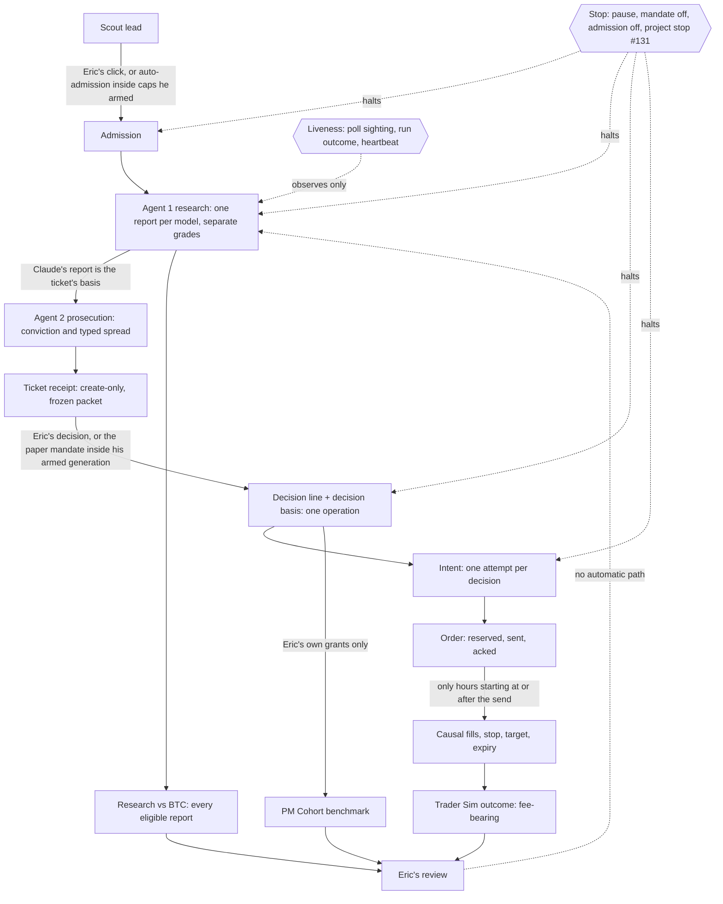

# Combined implementation blueprint: borrowed tools × grade outcomes

**Date:** 2026-11-02 (EST). **Revision:** 3. It replaces revision 2 (`effac8c`) in the same PR, #134. **Status:** design only and proposed; this PR implements nothing.
**Supersedes:** PR #132 (Codex, `aa5ad1d`) and PR #133 (Claude, `a90676e`). Both stay open and unchanged until Eric decides.
**Baseline:** `main` at `84cb28a`. Every `path:line` refers to `84cb28a` unless it is marked **#131**, which means PR #131's head `71c4c1a`. Vendor facts cite the vendor's page, read on 2026-11-02. **UNVERIFIED** marks anything not confirmed in source or on a primary page.

**Status words:**
- **Proposed:** written here only.
- **Implemented on a branch:** code exists in an open PR.
- **Merged:** in `main`.
- **Deployed:** running on the online desk.
- **Proven in operation:** shown by records from a real run.

Everything here is proposed, except #131. #131 is implemented on a branch; it is not merged, deployed or proven.

## 1. Decision summary

Keep the desk. Borrow only a scheduler and an external heartbeat. Freeze grade lineage at the point where the desk already freezes decisions.

1. **Stop halts everything.**
   - PR #131 implements one shared gate on a branch.
   - Until Eric merges it, the pilot still ignores an autonomy stop (`DESK_STATE.md:392`).
2. **Honest liveness.**
   - Today `runAll` exits 0 after an agent failure, a prompt-integrity failure, a refused prepare, and a report or ticket the desk refused (§6.1). So neither the exit code nor `agent_failed` alone can say "research is flowing".
   - Proposed: the runner classifies every outcome, and the desk shows five separate facts.
   - An optional external heartbeat pings from that classification, not from the exit code.
3. **Decision-time basis.**
   - Each decision already commits under one lock, and its effects run afterwards (§5.1).
   - The research and authority basis is staged as one create-only file in the **same operation** as the decision line. A later effect never rebuilds it from current settings.
   - Execution assumptions come from the book's own reservation and fill events. No second ledger is added.
4. **Attribution identity is not a cohort.**
   - A decision is the unique attribution identity.
   - Statistical grouping is defined separately, and a group can hold many positions.
   - No rate is shown until Eric sets the count (Q3). The 20-report research threshold does not carry over to trades.
5. **No order-lifetime PR.** `trader-desk.assess` already waits until an order's life holds a whole hour after it is sent (`dashboard/core/trader-desk.js:548-552`).
6. **The canary does not wait for metrics or UI.**
   - B0 and B1 need none of the attribution work.
   - B2 (a fill) waits for the decision-basis PR to be deployed (Q5). Otherwise its lineage reads "reconstructed".

No npm dependency, engine, queue, MCP server, claim state or grade band is added. Five Eric questions (§11) gate the policy choices.

## 2. One-sheet lifecycle (CONSTITUTION Part 4 Q2, `docs/CONSTITUTION.md:75`)

Outcomes reach Eric only. No arrow runs from an outcome to a grade, a rubric, the mandate or admission. Changing any of those is Eric's own act, under the desk's existing versioning (published templates are never edited, per `CLAUDE.md`).

## 3. Canon conflicts to resolve first (docs-only PR)

| # | Conflict | Lines | Resolution proposed for Eric |
|---|---|---|---|
| C1 | Scout leads are admitted "only by Eric's click", yet bounded auto-admission exists | `CLAUDE.md:36` vs `DESK_STATE.md:322`, `dashboard/core/lead-admission.js:2-13` | CLAUDE.md states auto-admission inside caps Eric armed |
| C2 | "Eric's grants route to it, and nothing else does", yet mandate grants route too | `DESK_STATE.md:465` vs `DESK_STATE.md:54-58`, `dashboard/core/tickets.js:1882-1918` | Reword: Eric's grants, or grants under an unexpired mandate generation he armed |
| C3 | "The pilot ignores an autonomy stop" | `DESK_STATE.md:392` | True at `84cb28a`. #131 removes it on merge. Until then no unattended runner change ships |
| C4 | Under #131 a PM veto or Undo also stops research sessions | #131 body, "Residuals" | CLAUDE.md latch text covers pilot, mandate and admission; rearm is the only un-stop |
| C5 | No one-sheet diagram exists | `docs/CONSTITUTION.md:75` | Commit §2 |

`package.json:4` (the server has no npm dependencies) is consistent with every proposal here.

## 4. Borrowed candidates

| Candidate | Verdict | Why (CONSTITUTION Q1-Q4, `docs/CONSTITUTION.md:74-77`) |
|---|---|---|
| Render Cron running the existing `pilot.js --pilot-all --desk=online` | Adopt only after Q1 and an outage drill | **Q1, serves the desk:** it is the clock for the research producers, so grades flow while Eric's PC sleeps. **Q2, one sheet:** one service. **Q3, network drop:** "Render guarantees that at most one run of a given cron job is active at a given time"; "Render delays the next scheduled run until the active run finishes"; a manual trigger "immediately cancels the active run"; "Render stops an active run after 12 hours"; cron jobs "can't provision or access a persistent disk"; "All day and time ranges use UTC" (https://render.com/docs/cronjobs). **Q4, deterministic math:** it touches none |
| `claude setup-token` → `CLAUDE_CODE_OAUTH_TOKEN` | Adopt with the cron | A one-year OAuth token that "can only make model requests", so it "can't … fetch claude.ai connectors". Bare mode "does not read `CLAUDE_CODE_OAUTH_TOKEN`". `ANTHROPIC_AUTH_TOKEN` and `ANTHROPIC_API_KEY` rank above it (https://code.claude.com/docs/en/authentication) |
| Healthchecks.io | Optional (Q2) | "interprets 0 as a success and all other values as a failure". `rid` matches a start ping to its result. "Please do not ping a single check more than 5 times per minute" (https://healthchecks.io/docs/http_api/). Period and grace time are set per check, and cron schedules take a time zone (https://healthchecks.io/docs/configuring_checks/). The docs say nothing about alerting during Healthchecks' own outage, so this design assumes none |
| Freqtrade, Hummingbot, QuantStats, Nautilus | Not adopted | No code or claim from them is relied on. The book already defines fills, fees and slippage (§5.6) |
| CCXT, broker MCP servers, claude-code-action, Temporal/Trigger.dev | Reject | Each brings a custody or live-money surface, merge authority (Law 1, `docs/CONSTITUTION.md:13`), or a second state machine |

## 5. Grade-to-outcome contract

### 5.1 What the desk already freezes (verified at `84cb28a`)

| Record | Immutable how | Evidence |
|---|---|---|
| Ticket receipt (the Prosecutor's ticket on one Claude report) | Create-only write | `dashboard/core/tickets.js:1503`. One ticket per Claude report: `:677-680` |
| Receipt contents | The record itself | `tickets.js:1449-1501`: the Prosecutor's `model.model_version`, `prompt_sha256`, `packet` {path, sha256}, `text.sha256`, `researcher` {report_id, run_id, grade, analysis_at, horizon}, `prosecution.conviction_score`, and `agent_disagreement.spread_points` = gate grade − conviction. The gate grade reads a range at its low end (`:276-281`) |
| Frozen packet | sha256 held in the receipt and checked on read | Includes the Claude report's `original_sha256`, rubric and profile (`tickets.js:684-688`) |
| Decision line `cr.ticket-decision.v1` | Appended under the operation lock | Lock opens at `tickets.js:1863`; line written at `:1971-1972`. A mandate decision also carries its generation, `armed_at`, `policy_sha256`, tier and grade used (`:1917`) |
| Decision effects (archive, journal, PM Cohort, trader) | Run **after** the lock; idempotent and repairable | `tickets.js:1976`, `:1985-2004`; repair by `reconcileEffects` (`:2111`) |
| Operation atomicity | Staged files commit together, and recovery rolls a sealed operation forward | `dashboard/core/ops.js:3-8` |
| Report original | `meta.original_sha256` and `meta.imported_at` (server save time) | `dashboard/core/inbox.js:153`, `:412` |
| Report corrections | Immutable entries layered over the original, including `eligibility` and score fields | `dashboard/core/reports.js:1274-1277` |
| Book reservation | Hash-chained journal event (`dashboard/core/paper-trader.js:690-711`) | Intent body and its sha256, quantity, notional, `loss_at_stop_usd`, effective expiry, the grant read under the lock, the exit cap, venue fee rates and `stop_slippage_bps` (`:796-806`) |
| Book fills and exits | Same journal | Quantity, price, notional, fee and fee kind (`paper-trader.js:1027`); exit proceeds and fee (`:988-995`) |

**Not frozen anywhere today:**
- other providers' reports available at decision time;
- report eligibility and correction state at decision time;
- the receipt's own hash;
- the code revision at decision, reservation or fill;
- `FILL_SHARE_MAX` (`paper-trader.js:147`);
- the `trader.rules` used at reservation.

### 5.2 Decision basis, frozen inside the decision transaction (proposed)

- **What and where.** One create-only file, `projects/<id>/tickets/basis/<decision_id>.json` (`cr.decision-basis.v1`).
- **When.** `decide` stages it inside its existing `runOp` (`tickets.js:1863`), in the same operation as the decision line. Both commit or neither does (`ops.js:3-8`).
- **What stays unchanged.** The decision line stays `v1`. The protected book reads decisions only as `cr.ticket-decision.v1` (`paper-trader.js:161`, `:315`).

**Contents.** Everything is read under the lock, as of `decided_at`.
- **Identity:** `decision_id` and `receipt_id`; `receipt_sha256`, the sha256 of the receipt bytes as read; and the receipt's `packet.sha256` and `text.sha256`, copied.
- **`research[]`:** one entry per provider in `PROVIDERS`, from the desk's own selector (`dashboard/core/compare.js:24-33`) run on the records as read under the lock.
  - Each entry holds: provider and role (`researcher`); `report_id` and `run_id`; `model_version`, or null with its `model_version_note`; `original_sha256`, `imported_at` and `analysis_at`; the prompt, rubric and profile versions.
  - It also holds the grade from `gradeAssessment`: status, value or range, coverage, and the reason for any missing component. It lists the correction IDs applied and sets `eligible_at_decision: true`.
  - A provider with no eligible report records `{state: none | held | excluded | pdf_only, reason}`. Unknown stays unknown, and no research is started to fill a gap.
  - Each entry is labelled either `decision_input` (the Claude report the receipt names) or `available_context` (any other provider).
- **`prosecutor`:** provider, `model_version`, `prompt_sha256`, `conviction_score`, verdict, and a typed spread copied from the receipt: `{kind: "researcher_gate_grade_minus_prosecutor_conviction", researcher_grade_used, conviction, points}`.
- **`authority`:**
  - For a mandate decision: the line's generation, `armed_at`, `policy_sha256`, tier and expiry.
  - For Eric's decision: `decided_by` only.
  - In both cases: the pause and project-stop state as the gate read them.
- **`code_revision`:** the running commit (`dashboard/core/revision.js:36-47`).

The basis never holds the current `trader.rules`, the fee or the book's funding. Those are execution context, applied when the intent is built (§5.3).

**Reproducing the basis later.** No effect writes the basis, so there is no basis effect to fail and repair.
- The attribution view is computed on read.
- It joins the basis to the decision line by `decision_id`, then reads each referenced record by ID and checks its sha256 (receipt, packet, report original).
- A mismatch is an `INTEGRITY` refusal (409) naming the record. This is the desk's existing rule for frozen records ("verifiedFrozen" in `CLAUDE.md`).
- The view never substitutes current values.

**Decisions made before this PR** have no basis file. Their view is built from the receipt, the packet and the report records that exist now, and is labelled `reconstructed`, never `decision_time`. Corrections dated after `decided_at` are listed as later annotations, never applied.

### 5.3 Execution context, captured where execution happens

**Where it is captured.**
- `trader-desk.assess` builds the intent only when the book can answer (`trader-desk.js:554-559`).
- The intent body holds `created_at`, the limit price (the lower of the book's price and the zone edge, `:402`), the stop, the target, the risk and `valid_until`. The reservation hashes that body (`paper-trader.js:752`, `:797`).
- The reservation also records the fee rates, the frozen `stop_slippage_bps` (`:806`), and the decision as read under the book's lock (`:802`).

**What is not recorded:** the engine revision, `FILL_SHARE_MAX` and the `trader.rules` digest. Two options (Q4):
- **(A), recommended.** A protected-core PR adds `engine` (`VERSION`, `paper-trader.js:143`), `fill_share_max` and `rules_sha256` to the `reserved` event, and `engine` to `fill` and `exit` events. It needs Eric's deliberate review (`docs/CONSTITUTION.md:50`; `dashboard/tests/trader-boundary.test.js`).
- **(B), if A is declined.** The view reports those three items as "not recorded at execution". It may show the current constant, labelled "current, not historical". Any deploy between `reserved.at` and a fill is listed from Render's deploy record as operating evidence.

**The link.** `decision_id` → `intent_id` (derived from the decision, `trader-desk.js:119`) → `client_order_id` `cr2-<intent_id>` (`paper-trader.js:792`) → `position_id` `pos-<intent_id>` (`:798`). Decision context comes from the basis, and execution context from the book's events. They are shown side by side and never merged.

**Acceptance scenario.** Proposed test `dashboard/tests/decision-basis.test.js`, in a fictional workspace:
1. A mandate grant commits with its basis.
2. The trader effect fails (stubbed).
3. `trader.rules` and the fee change.
4. `trader-desk.step` reserves, and an hour fills the order.
5. `tickets reconcile` runs.

It asserts that:
- the basis bytes are unchanged;
- the view shows the original report vector, generation and `policy_sha256`;
- the view shows the new fee and rules from the reservation, labelled execution-time;
- a corrupted basis or receipt is refused, never rebuilt;
- a decision from before the PR reads `reconstructed`.

### 5.4 Attribution identity and statistical grouping

**Identity.**
- One row per decision that grants risk, keyed by `decision_id` (`tickets.js:1971`). Its execution key is `position_id`.
- A trade linked to several reports is still **one executed policy outcome**, and no model "earned" its profit or loss.
- Claude's report and the Prosecutor were the decision's inputs. Any other provider's report was context.

**Why revision 2's cohort fails.** Revision 2 grouped by mandate generation × the exact decision-time report vector, and required 20 closed positions per group. That can never accumulate:
- Each Claude report gets one ticket (`tickets.js:677-680`), and the mandate grants a receipt once (`:1899`). So the exact vector is almost always unique per decision.
- A generation lasts 1-30 days (`dashboard/cli.js:106`), at 1 grant a day by default (`tickets.js:1547`).
- So a group holds about one position.

The "20" was borrowed from `report-outcomes.js:31` (`MIN_COMPARABLE`, matured reports per model per horizon) and `paper.js:37` (`MIN_CLOSED`, PM Cohort). Neither one establishes a trade threshold.

**Statistical grouping (proposed, Q3).**
- A group key is the set of fields Eric chooses from:
  - `decided_by` kind (Eric or mandate);
  - the Claude researcher's `model_version`, prompt and rubric versions;
  - the Prosecutor's `model_version`;
  - the execution policy (engine, `rules_sha256`, fee tier).
- Provider, model version and role are always separate dimensions, never pooled.
- Agent 1 against Agent 2 (the spread) is a different comparison from Claude against ChatGPT.
- ChatGPT's reports are never decision inputs here. They appear as context and in the research-vs-BTC view (§5.5).

**Denominators, always shown.** Every rate states its numerator and its denominator:
- decisions granted;
- intents `not_opened` (final or not), `waiting` or `refused`;
- orders reserved;
- filled in full, filled in part, unfilled (expired or cancelled), or `UNKNOWN`;
- positions open or closed;
- closed with every fee known, or incomplete;
- excluded, with the reason.

No rate appears at any count until Eric sets a minimum number of closed positions (Q3). The rationale he weighs: for n closed trades, a hit rate's 95% interval is at worst about ±0.98/√n, so ±22 points at 20 and ±14 points at 50. No grade bands and no model ranking.

### 5.5 History when eligibility changes; three views kept apart

- **Book outcomes stand.** A later quarantine, exclusion, correction or revision never edits the basis or the book. A position's profit or loss stays in the Trader Sim totals.
- **Changes become annotations.** The view adds a note such as "report r excluded on date d, after the decision", read from the correction entry (`reports.js:1274-1277`).
- **Analytical exclusion** is an explicit filter with a stated rule, and it always prints "n excluded of N". It never quietly improves a sample.

**The three views stay distinct:**
1. **Research vs BTC:** every eligible report, traded or not (`dashboard/core/report-outcomes.js:31`, `:218`).
2. **PM Cohort:** Eric's own grants only, at the signal price with unknown costs (`dashboard/core/paper.js:18`, `:37`). A mandate grant opens none (`tickets.js:1963-1964`).
3. **Trader Sim:** fee-bearing fills (`paper-trader.js:1077-1127`).

**Selection visibility.** The attribution view shows "traded k of n eligible Claude reports in the window", and lists the untraded and vetoed tickets and the desk's $0 gates. Selected trades never pass for an unbiased model comparison.

### 5.6 Order timing and fills (no new guard)

**When an order is live and when it expires.**
- The intent is created at `created_at`, with `valid_until = created_at + life` (`trader-desk.js:556-558`).
- The book's effective expiry is `min(valid_until, created_at + rules.max_validity_minutes)` (`paper-trader.js:791`).
- `live_from` is the send time (`paper-trader.js:422`), or the venue's ack time when no send is on record (`:427`).
- An hour starting at `t` can fill the order only if `t ≥ live_from` (`:986`).
- An order whose effective expiry falls before the hour's end expires before that hour is applied (`:996-998`).
- `assess` waits, in words, until the first whole hour after now fits inside the life (`trader-desk.js:548-552`). So a life under 60 minutes waits rather than expiring unfilled.

**Revision 2's "order-lifetime trap" and `fix/intent-life-floor` PR are withdrawn: the guard exists.**
- Arming accepts 1 to 10,080 minutes (`DESK_STATE.md:235`).
- Refusing a life under 60 at arming would be an optional usability refinement.
- A universal 120-minute floor would be a new policy, and nothing shows it is needed.

**Fill mechanics, unchanged.**
- A buy fills when the hour's low is below the limit, at the lower of the open and the limit (`paper-trader.js:1015`, `:1023`).
- A fill is capped at `FILL_SHARE_MAX` (10%) of the hour's volume, in whole lots (`:147`, `:1017`).
- The fee is charged, and cash must cover it (`:1025-1026`). An unknown fee refuses the reservation (`:771-775`).
- In the entry's own fill hour, only the stop is checked (`:1029`).
- For held positions, the stop is checked before the target, and a gap fills at the adverse price (`:1001-1004`).

**Generic illustration.** This is not a recorded trade. The fee rate is assumed, since Eric's fee has no default. The order is a LIMIT buy of 100 units at $10.00, with a 0.10% taker fee.

| Hour | Market | What the book does | Money |
|---|---|---|---|
| 1 | open $10.05, low $9.90, volume 400 | Cap is 40 units. 40 fill at min($10.05, $10.00) = $10.00. The stop at $9.50 is not touched | Notional $400.00; fee $0.40 |
| 2 | open $10.70, high $10.90 | The $10.80 target exits all 40 units at max($10.70, $10.80) = $10.80. The unfilled 60 units are cancelled (`:994`) | Proceeds $432.00; fee $0.432 |

Net is $432.00 − $400.00 − $0.40 − $0.432 = **$31.168**. The signal-price figure, 100 × ($10.80 − $10.00) = $80, is not the outcome.

## 6. Liveness

### 6.1 Runner outcomes, traced through `runOnline` (`pilot.js:711-782`) and `runAll` (`:863-970`)

| Outcome | Where | Today: row, exit | Proposed class → ping |
|---|---|---|---|
| Report or ticket saved and verified | `pilot-worker.js:214`, `:235`; `pilot.js:777` | `done`, 0 | ok → `/0` |
| No work, or the ticket waits at PM review | `pilot.js:727-730` | `done`, 0 | idle → `/0` |
| Desk gate closed (risk hold, $0) | `pilot.js:741` | `done`, 0 | idle → `/0` |
| Automation paused | `pilot.js:899-901`; claim at `pilot-claims.js:133` | 0 | idle-paused → `/0`; the desk shows paused |
| Session ceiling or agent cap | `pilot.js:925`, `:930`, `:725` | `session_ceiling`/`cap`, 0 | idle → `/0` |
| Another runner holds the claim | `pilot-claims.js:143`; `pilot.js:731` | `not_dispatched`, 0 | attention → `/fail` |
| Local lock held | `pilot.js:882-885` | skipped, 0 | attention → `/fail` |
| Agent authentication or generation failure | `pilot.js:759-761` | `not_dispatched`, **0** | failure → `/fail` |
| Prompt integrity failure | `pilot.js:750` | `not_dispatched`, **0** | failure → `/fail` |
| Prepare refused | `pilot.js:740`, `:746` | `not_dispatched`, **0** | failure → `/fail` |
| Report or ticket refused by the desk | `pilot-worker.js:206`, `:223`; `pilot.js:779` | `not_dispatched`, **0** | failure → `/fail` |
| Unverified save, or any uncertain step | `pilot.js:738`, `:745`, `:759`, `:775`, `:778` | needs Eric, **3** | reconcile → `/3` |
| Project stopped by Eric | #131 `pilot.js:519`, `:965` | `stopped`, 0 (branch only) | idle-stopped → `/0`; the desk shows stopped |
| Session isolation not established | preflight `pilot.js:486-489`, caught at `:964-967` | **1** | failure → `/1` |
| Dispatch exception or poll failure | `pilot.js:943`, `:964-967` | `error`, 1 | failure → `/1` |
| Process killed, or Render's 12-hour stop | — | no final ping | Healthchecks marks it late, if Healthchecks is up |

**Proposed change.**
- The runner keeps today's exit codes, so existing schedulers and the readiness runbook keep their meaning.
- It adds a `health` class per row, and a run-level class (the worst row), to its log line. The class comes from `row.stop`, not `row.outcome`.
- A refused grade is never reported as success.

**Pings.**
- At most two per invocation: `/start?rid=` and one final ping.
- Bare GET, no body, 5-second timeout, and a failed ping is ignored.
- A ping never changes the exit code, releases a claim or touches authority.
- The ping URL is a secret held in the cron environment only. The `ENV_KEEP` allowlist (`pilot.js:152-159`) has no `CR_*` names, so the URL never reaches a session.

### 6.2 Five separate facts on the desk (no new claim state)

| Fact | Source |
|---|---|
| Last server-observed production poll | Proposed narrow worker `poll` POST under the existing worker bearer (`pilot-worker.js:43-46` lists four routes today). It writes `{last_polled_at (server clock), runner_id, invocation_id}` only after the queue snapshot is computed. GET stays read-only (`pilot-poll.js:80-109`) |
| Latest dispatch and save outcome | The existing claim record per project, with its `outcome` on release (`pilot-claims.js:274`), plus the session ledger (`DESK_STATE.md:278`) |
| Report save and analysis dates | `meta.imported_at`, `assessment.analysis_at` |
| Data freshness | The existing price and ATR waits (`trader-desk.js:535-547`) |
| Authority | Mandate generation and expiry, admission, pause, project stop: existing settings and `POST /api/projects/<id>/autonomy` (`dashboard/server.js:1279`) |

STALE means the production poll is overdue. It is not proof that no grade exists or that no session is running.

### 6.3 Timing: measured, estimated, bounded

**Measured:** nothing yet; no production cron run exists.

**Bounds from code.** These assume the child is killed at its timeout and that fetch aborts are honoured. Runtime is UNVERIFIED.

| Step | Bound | Source |
|---|---|---|
| Poll | 30 s | `pilot.js:851` |
| Claim or prepare | 120 s each | `pilot.js:653` |
| Session | `timeoutMin`, 60 min by default | `pilot.js:56`, `:466` |
| Each `complete` attempt | 300 s | `pilot.js:682` |
| Backoff between `complete` attempts | 31 s in total | `pilot.js:673` |
| Claim life | 90 min | `pilot-claims.js:57` |
| Isolation probe | 60 s | `pilot.js:434` |

- No `complete` retry starts after the claim's expiry (`pilot.js:689-691`).
- Expiry does not cancel an attempt already in flight, so the last attempt can end about 5 min after expiry.
- How the desk handles a `complete` that arrives after expiry is not traced here (UNVERIFIED).

**Worst gap between two sightings at `--max-agents=1`: about 110 min.**
- One claim, from the claim to its last `complete` reply, takes up to about 95 min.
- Add up to 3 non-session iterations of claim and prepare (`MAX_STEPS` 4, `pilot.js:48`): a few minutes at worst, seconds in practice.
- Add the 30 s re-poll (`:952`).
- Render then starts the delayed run as soon as the active one finishes.
- The conservative estimate for a healthy run is about 65 min.
- At the default `maxAgents` of 2, two claims in one project reach about 200 min.

**Proposed STALE threshold.** 120 min at hourly cron and `--max-agents=1` (Q2). Raising `--max-agents` requires STALE ≥ maxAgents × 95 + 15 min, set in the same PR.

### 6.4 Credential boundaries

**OAuth token: reaches the CLI, not the model.**
- `CLAUDE_CODE_OAUTH_TOKEN` must reach the official CLI process, so it is on the allowlist (`pilot.js:157`).
- Sessions get only WebSearch and WebFetch (`:45`). Bash, Read and MCP tools are denied (`:146`), and claude.ai MCP servers are disabled (`:172`). So the token sits in the process environment but cannot be read through a tool.
- The isolation probe strips the token (`:405`).
- The allowlist already drops `ANTHROPIC_API_KEY`. It must also be absent from the cron environment, because it outranks the OAuth token.
- `--bare` is never passed; it does not read the OAuth token.

**Desk bearers: runner only.**
- The poll and worker bearers stay in the runner. Today they come from `secrets.json` (`pilot.js:640-647`, `:831-839`); the proposal reads env first.
- They are never placed in argv, logs, the prompt or a session.

## 7. Model blindness, scoped

**Claim.** The inputs to initial research and to prosecution exclude historical evaluation and outcome material.
- The research packet already excludes other models' reports (`dashboard/core/research.js:874-909`).
- Report outcomes are computed on read and are not stored (`CLAUDE.md`, "Outcomes").

**Proposed test** (`dashboard/tests/grade-input-blindness.test.js`).
- Plant canary strings in an outcome view, a PM Cohort row, a Trader Sim position, and another provider's grade.
- Assert that none appears in a research packet or prompt, a Prosecutor prompt, or the mandate, admission or rubric inputs.

The test proves only those code paths. It cannot prove that a model never meets outcomes on the open web. A post-mortem Eric authorizes later is a separate, labelled exercise, and it never feeds an original grade.

## 8. Failure states

| ID | Failure | Guard |
|---|---|---|
| F01 | Two schedulers, or a manual trigger mid-run | One production scheduler. Claim, prepare and bind are authoritative (`pilot-claims.js:131-176`). Render cancels the active run on a manual trigger, so the runbook forbids triggering while a session runs |
| F03/F7 | A paid answer lost on an ephemeral host | Today the pending file holds the answer (`pilot.js:770`); on a cron host it is lost with the disk. Guards: the Q1 drill; the claim stays and reads reconcile, exit 3; proposed row 4 prints IDs and `text_sha256` only; no new session until Eric reconciles |
| F3 | Expired or revoked token: every session fails, exit 0 | `health` = failure, so `/fail` (§6.1). A calendar reminder before the one-year expiry. The session ceiling (`DESK_STATE.md:278`) bounds the waste |
| F5/F6 | The model or CLI drifts | `--model` required on unattended runs (validated, `pilot.js:191`); CLI version pinned |
| F09-F12 | The token reaches the desk, the browser, a prompt or a child environment | Cron-only secrets; allowlist test (§6.4) |
| F13-F17 | False freshness | A POST sighting only after a real queue read, on the server clock; unknown when the record is corrupt |
| F18 | A refused grade shown as research done | `health` comes from `row.stop` (§6.1) |
| F11-F12 | The mandate generation or report changes after a decision | Basis frozen in the decision's operation (§5.2) |
| F13b | A report is quarantined later | Annotation only; profit and loss kept (§5.5) |
| F14 | An unfilled, partial or unknown position | Its own denominator row, never zero (§5.4) |
| F16 | A signal-price result shown as the outcome | Only executed fills count (§5.6) |
| F19 | An engine or rules change reprices history | Q4 (A) stamps them at execution; otherwise "not recorded" |
| F26 | A period win rate shown as a trade hit rate | The unit is a closed position; formulas are versioned |
| F27 | Outcomes reach a grade | §7 tests, scoped to code paths |
| F28 | Rates on tiny samples | No rate until Q3 |

## 9. Ordered build plan (one PR each, Law 3)

Every test named below is **proposed** and not yet passing. Each PR runs `node dashboard/cli.js test`. Protected files stay byte-identical unless the row says [P].

| # | Outcome | Depends | Acceptance | Proof |
|---|---|---|---|---|
| T0 | One stop halts pilot, mandate and admission (**implemented on a branch, #131**) | Eric's merge and deploy | #131's residuals (a)-(e) acknowledged | #131's `stop-halts-pilot.test.js`. Its body reports 16 tests and 1543 pass / 0 fail on Windows. Not proven in operation |
| 1 | Canon sync C1-C5 and the §2 diagram (docs) | T0 merged | Every §3 line resolved | Docs review; `test` unchanged |
| 2 | Desk controls and evidence-based reconciliation | T0 | The five facts of §6.2 shown apart. Off-only pause, mandate, admission and project-stop controls with readback, reusing `server.js:1279`. Reconcile is explicit and signed in, through the existing release route (`server.js:1288`); never a blind retry | Proposed `pilot-controls.test.js`; a browser check that STALE and a fresh report show together |
| 3 | Runner outcome classification | — | Every §6.1 row yields its class; exit codes unchanged | Proposed `pilot-outcome-class.test.js`, one case per row |
| 4 | Runner env and credentials | 3 | Bearers from env first; `--model` required unattended; allowlist pinned; stdout carries IDs and `text_sha256` only for a lost complete | Extend `dashboard/tests/pilot-all.test.js` |
| 5 | Host recovery on an ephemeral disk | 4 | Covers an answer saved but its reply lost, the desk down, and the runner killed. A restart never regenerates | Proposed `pilot-host-recovery.test.js` |
| 6 | Production poll sighting | 4, Q2 | GET unchanged. A forged clock or a failed snapshot never freshens the record. STALE at the Q2 value | Proposed `pilot-liveness.test.js` |
| 7 | Heartbeat pinger (only if Q2 adopts it) | 3 | At most 2 pings. A failed ping never changes the exit code or authority | Proposed `pilot-healthchecks.test.js` with a stubbed fetch |
| 8 | Decision basis in the decision's operation | 1 | §5.2 contents. Atomic with the decision line; the v1 line unchanged; read-time join; the `reconstructed` label | Proposed `decision-basis.test.js` (the §5.3 scenario) |
| 9 | [P] Execution stamp (only if Q4 is A) | 8 | `engine`, `fill_share_max` and `rules_sha256` on `reserved`; `engine` on `fill` and `exit`. Replays of old journals unchanged | Protected tests plus a proposed case in `trader-boundary.test.js`; Eric's manual review |
| 10 | Same-engine continuous, restart and replay equivalence | 9, or option B | In a fictional workspace, the same bars, controls, clock, funding and decisions give identical events and results whether run continuously, restarted or replayed (`paper-trader.js:395-399`). Changed input is refused; missing history reads incomplete | Proposed `paper-replay-parity.test.js` |
| 11 | Input blindness | 8 | §7 assertions | Proposed `grade-input-blindness.test.js` |
| 12 | Attribution view (read-only) | 8, 10, Q3 | §5.4 denominators; the three views kept apart; the $31.168 illustration exact | Proposed `grade-outcome-view.test.js` |
| Ops-1 | Render cron definition (disabled) and its runbook | 3-6, Q1 | UTC schedule, `--max-agents=1`, pinned model and CLI. Eric creates the service and its secrets. PC task disabled at cutover | Linux dry run; outage and kill drill recorded (operating evidence) |
| B0 | Canary prerequisites | T0, 2 | Deployed SHA, meters, credentials through safe paths, readbacks (`docs/engineering/BOUNDED_PAPER_READINESS.md:607-652`) | Recorded readbacks (operating evidence) |
| B1 | Cancellation proof | B0 | Lineage recorded; cancelled before the first causally eligible hour (`BOUNDED_PAPER_READINESS.md:654-665`) | Authoritative order records. A command's success is not proof |
| B2 | One legitimate fill and its risk management | B1, row 8 deployed (Q5) | A supported successor with caps unchanged. Fill, fees, stop and basis recorded (`BOUNDED_PAPER_READINESS.md:683-698`) | Linked records. A correct no-trade is "held", not a fill |
| B3 | Restart and idempotency | B2 | No duplicate session, grant, order or fill (`BOUNDED_PAPER_READINESS.md:700-713`) | IDs compared; a hosted restart only if authorized |

**Canary ordering.**
- The PC runner (`BOUNDED_PAPER_READINESS.md:612-616`) serves B0-B3, so the cron is off the canary's critical path.
- The only attribution prerequisites are row 8, plus row 9 if Q4 is A, and only for B2.
- Row 12 and any UI can follow the canary.

## 10. One-sheet cost

| Item | Added |
|---|---|
| Vendors | +1 only if Q2 adopts Healthchecks; Render and Anthropic are already in use |
| Services | +1 Render cron (Q1); −1 PC scheduled task at cutover |
| Secrets | `CLAUDE_CODE_OAUTH_TOKEN`, plus the ping URL if Q2. The existing poll and worker bearers move to the cron environment. No new bearer type |
| Records | +1 create-only basis per decision; +1 bounded runner-sighting record; book event fields only if Q4 (A) |
| Worker ops | +1 `poll` (POST) |
| States | 0 new claim, order or ticket states; display labels only |
| npm deps, engines, MCP servers, queues | 0 |
| PRs | T0 (open), 12 build PRs, Ops-1, and the B0-B3 evidence records |

## 11. Eric's questions (the defaults are proposals, not approvals)

1. **Runner host.** Move the production runner from the PC to Render cron?
   - *Default:* yes, but only after rows 3-6 and the outage and kill drill.
   - Accept that an answer can be lost if the desk is unreachable until the run ends. The claim then reads reconcile, never auto-LOST.
   - Keep the PC runner for B0-B3.
2. **External heartbeat and STALE.** Adopt Healthchecks (one vendor, one secret URL)?
   - *Default:* yes, alerting Eric only.
   - STALE at 120 min for hourly cron at `--max-agents=1`.
3. **Statistical grouping and sample size.** Which §5.4 fields form a group, and how many closed positions before any rate is shown?
   - *Default:* group by `decided_by` kind × Claude researcher model version × execution policy.
   - Show counts and rows only until Eric names a number. The interval rationale is in §5.4.
4. **Protected-core execution stamp.** Authorize the [P] PR (row 9) that records the engine, `fill_share_max` and the rules digest on book events?
   - *Default:* yes (option A), reviewed by hand under `docs/CONSTITUTION.md:50`.
5. **B2 gating.** Hold B2 until row 8 (the decision basis) is merged and deployed?
   - *Default:* yes. B0 and B1 proceed without it.

## 12. What to close

This PR (#134) holds one file. After Eric approves the design, close #132 and #133 as superseded, without merging. #131 stays open as T0, for Eric to review and merge.

## Verification log

**Revision 3 (2026-11-02).**
- **Repository state.** `main` is `84cb28a` after `git fetch`. #131 is OPEN at `71c4c1a`, #132 OPEN at `aa5ad1d`, #133 OPEN at `a90676e`. #134 was at `effac8c` before this revision.
- **Governing files read:** `docs/CONSTITUTION.md`, `CLAUDE.md`, `DESK_STATE.md`.

**Findings in the revision brief, checked against source:**
- **Effects run after the decision transaction:** confirmed (`tickets.js:1863`, `:1972`, `:1976`). The basis now moves inside the operation (§5.2). The decision line is not changed, because the protected book pins `v1` (`paper-trader.js:161`, `:315`).
- **The cohort cannot reach 20:** confirmed (`tickets.js:677-680`, `:1899`, `:1547`; `cli.js:106`). Identity and grouping are now separate (§5.4).
- **The lifetime-floor PR duplicates an existing guard:** confirmed (`trader-desk.js:548-552`). The PR is removed (§5.6).
- **Exit 0 hides failures:** confirmed for agent failure, prompt-integrity failure, a refused prepare, and a desk-refused report or ticket (`pilot.js:948`, `:962`). They are classified in §6.1.

**Corrections to revision 2:**
- **Isolation refusal row was wrong.** Revision 2 said exit 0 → `/fail`. Preflight throws, and `runAll` catches it as exit 1 (`pilot.js:964-967`).
- **Fill example was wrong.** It filled a buy above its signal price, which a LIMIT buy cannot do (`paper-trader.js:1015`, `:1023`). It is replaced by a labelled illustration (§5.6).
- **Timing was understated.** The last `complete` attempt can run past claim expiry (`pilot.js:682`, `:689-691`). Bounds recomputed: about 110 min at `--max-agents=1` and about 200 min at 2; the raise rule is now ≥ maxAgents × 95 + 15.
- **"Proposed fields" snapshot written by a late effect:** replaced by an in-transaction basis.
- **"20 closed positions per cohort":** removed; Q3 now asks for the threshold.
- **Eight questions:** reduced to five.
- **T1 reported as "done":** now stated as implemented on a branch, not merged.

**Resolved UNVERIFIED items:**
- Render: the delayed next run, the 12-hour stop and UTC scheduling (https://render.com/docs/cronjobs).
- Healthchecks: period, grace time and cron time zone (https://healthchecks.io/docs/configuring_checks/).
- The Freqtrade and Nautilus claims are removed rather than relied on.

**Still UNVERIFIED:**
- That the session child is killed at its timeout, and that fetch aborts are honoured, in production.
- How the desk handles a `complete` that arrives after claim expiry.
- Healthchecks alerting during its own outage: its docs say nothing.
- Every operating milestone, B0 to B3: none is proven.
